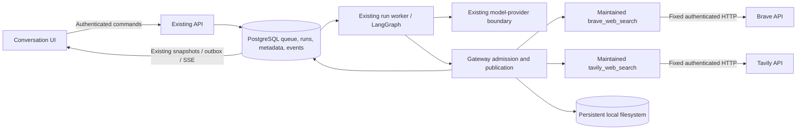

# Phase 4: Trusted Tools and Persistent Conversation Files

## 1. Agreed direction and review status

This specification supersedes the earlier log-summary/sandbox-first Phase 4 draft. It implements the boundaries agreed during review of [the roadmap](../../roadmap.md#phase-4--trusted-tools-and-persistent-conversation-files) and [architecture](../../architects.md). The user approved implementation on 2026-10-20; the [implementation plan](../plans/2026-10-19-phase4-execution-and-conversation-workspace.md) tracks work and review gates.

**User-agreed decisions:**

- Phase 4 has separate `brave_web_search` and `tavily_web_search` maintained tools, using operator-configured API-key references. There is no combined `web_search` provider router, new Search Provider framework, or separate Connection entity.
- Trusted tool code belongs to the OpenShip distribution and executes through the existing runtime worker/gateway. It needs no sandbox. The HTTP API admits commands; durable work does not move into long-lived request handlers.
- Phase 5's existing Connector domain owns browser configuration, project/service bindings and protected persistent credentials for those tools and cloud integrations. Vault is optional later; no Phase 4 credential-management UI or secret database.
- All sandbox implementation moves to Phase 6: driver installation/scripting, image builds, authenticated worker protocol, resource enforcement, cancellation/cleanup and actual isolation qualification. No sandbox manager, image, runtime or subprocess executor is implemented in Phase 4.
- Phase 4 establishes basic filesystem artifacts and persistent conversation directories. Phase 6 adds editable logical files, captured immutable versions and per-output mutability. Repeated in-place agent edits are a requirement for later source/configuration work, including Terraform; immutable-only workspaces are not the long-term design.
- One user initially, one active run per conversation, configurable installation capacity with queued waiting, conservative visible interruption rather than automatic redispatch, and no optimization objective.
- OpenAI Chat Completions is 4B's first qualified tool-capable model adapter; retain accepted text behavior for all existing adapters.

The base schemas, values and interfaces below are the approved implementation target. Following the user's Phase 4A walkthrough, the composer and result presentation amendment in §8.1 was approved for Task 9A implementation. Its three requirements are compact inline search results, a tool attachment menu below the input, and a compact model dropdown defaulting to `gpt-6-luna`. The implementation and fixture evidence are recorded in the plan and acceptance record; the user visually accepted the result on 2026-10-20 and directed continuation through the remaining plan. This specification does not claim that later phase tasks or live provider qualification are complete.

### Acceptance units

| Unit | Runnable outcome |
| --- | --- |
| 4A | Explicitly run each service-specific search tool through the existing run/operation lifecycle without a model call; retain a normalized result artifact. Qualify Brave first, then Tavily independently. |
| 4B | One qualified OpenAI profile requests those same tools through a bounded model/gateway loop, with evidence-linked final answers. |
| 4C | Reopen a conversation after restart, find/read retained files through bounded workspace tools and select exact versions for continued work. |

Each unit preserves prior accepted journeys and gets a separate user accept/revise/stop decision. Exclude generated code, executable imports, MCP, semantic discovery, cloud credentials/mutations, managed Connectors, browser key entry, editable files, generic plugins, object storage and cross-host filesystems.

## 2. Architecture and foundation ownership



The gateway is the sole tool admission/publication boundary. Maintained functions may share DTOs and bounded HTTP helpers; they remain separately registered tools with separate credential requirements, destinations and failure outcomes. Models choose exact tool IDs, not a hidden provider selector. Workspace listing/reading in 4C uses the same gateway.

| Phase | Owns |
| --- | --- |
| 4 | Exact tool registry, operations/fencing, operator credential references, two search implementations, bounded model loop, filesystem artifacts and conversation-file persistence/list/read |
| 5 | Managed Connectors, browser setup, encrypted persistent credentials, rotation/revocation, cloud account/environment/target bindings and delegated credentials |
| 6 | Sandbox execution and install/image lifecycle, generated code, editable file heads, version history and enforced output mutability |

No duplicate queue, runtime, event service, secret store or search-routing domain. Keep Python 3.11 minimum, PostgreSQL 15, FastAPI/Pydantic 2, LangGraph, Vue/TypeScript and existing model contracts. The existing Phase 3 `ProviderProfile` remains a model concept, not a base class for search/cloud services.

## 3. Requirements

| ID | Requirement | Unit |
| --- | --- | --- |
| R01 | Preserve existing run/queue/event/auth/title/history behavior; support model-free tool runs and versioned graphs | 4A |
| R02 | Separate exact tool IDs, immutable manifest digests, enablement and owner-based gateway authorization | 4A |
| R03 | Durable logical operations, separate attempts, intent before I/O and fenced publication | 4A |
| R04 | Operator-only credential references; no secret persistence/UI; explicit future Connector migration boundary | 4A |
| R05 | Fixed-destination bounded/cancellable search HTTP with no result-URL fetching or arbitrary endpoint access | 4A |
| R06 | Cancellation/lease loss/interruption cannot produce stale results or hidden redispatch | 4A |
| R07 | Immutable filesystem artifacts, staged atomic visibility, safe bounded uploads/downloads and quotas | 4A |
| R08 | Independently conforming Brave/Tavily tool implementations and truthful search provenance | 4A |
| R09 | Authoritative operation/artifact snapshots, semantic events and browser reconnect behavior | 4A |
| R10 | Normalized model/tool messages, exact tool IDs and qualified OpenAI function calling | 4B |
| R11 | Cumulative budgets, sequential calls and configurable shared capacity with waiting | 4A/4B |
| R12 | Complete durable tool transcripts, partial-output retry protection and final-only answer/title publication | 4B |
| R13 | Persistent conversation association without another store or file migration | 4C |
| R14 | Bounded current-conversation list/read tools and retained-file continuation after restart | 4C |
| R15 | Predictable missing-storage, concurrent creation, quota, deletion and retention behavior | 4C |
| R16 | Compatible additive migrations, protected downgrade and coordinated DB/filesystem restore | All |
| R17 | Distinct unit/real PostgreSQL/filesystem/browser/real-stack/live evidence; no Phase 4 sandbox gate | All |
| R18 | Secret-safe errors/audit and untrusted search/file content cannot change authority or execute browser code | All |
| R19 | Compact chronological tool results, one composer with tool attachments, and a model dropdown defaulting to the configured `gpt-6-luna` profile; screenshot-led UX review before acceptance | 4A revision/4B |

## 4. Capability and execution contracts

All boundary DTOs are frozen Pydantic models with forbidden extras, strict bounded numbers and serializable data only. Canonical JSON is UTF-8, sorted keys, compact separators, rejects duplicate keys and non-finite numbers, and is hashed with SHA-256. Cryptographic identity detects change; installation/review authority establishes trust.

### 4.1 Exact catalog and output policy

`CapabilityManifest` has schema version 1, canonical `id`, version `1.0.0`, implementation/package revision digest, manifest digest, input/output schemas, effect classification, enablement requirements, limits, output policy and execution kind `maintained`. Image/entrypoint/manager fields do not belong to maintained-tool manifests. Phase 6 adds the sandbox execution kind through an explicit compatible contract revision.

4A registers `brave_web_search` and `tavily_web_search`; 4C adds maintained `workspace_list_files` and `workspace_read_file`. Exact lookup and current enablement are rechecked before dispatch. A model/client cannot supply Python implementations, paths, environment variables, endpoints, credentials or increased limits. Public schema/catalog views omit credential binding names and private configuration.

Each output descriptor carries `mutability`. Phase 4 only dispatches `immutable` output policies; a declared `mutable` policy is unsupported until Phase 6. Immutable artifact IDs identify captured versions. Phase 6 can add a logical-file ID/current head without changing those version IDs or redefining past outputs. No unused mutable-file table, edit API or workflow engine is built in Phase 4.

### 4.2 Runs and admission

Add `Run.kind` (`chat|tool`, default/backfill `chat`), `graph_version` (default/backfill 1), nullable `execution_configuration`, `execution_started_at` and `execution_deadline_at`. Existing provider snapshots remain unchanged. Chat v1 retains existing text behavior; manual tool v1 uses no provider snapshot or fabricated user/assistant message; tool-enabled chat v2 extends the existing graph. Unknown graph/schema versions fail execution safely without hiding historical messages.

`ExecutionConfig` schema version 1 pins graph identity, allowed capability refs/digests, exact selected artifact refs, non-secret tool settings/credential references, effective limits and loop limits. No key values are copied. Manual admission accepts `ToolCommandRequest(client_request_id, capability: CapabilityRef, arguments: dict)`. Chat submission adds `enable_tools: bool=false` and optional explicitly selected `artifact_ids`; search requires no file upload. Browser requests cannot name a credential source or alter tool settings.

Lock the owned conversation before checking for an active run. Submit command/run/job/event/outbox in one transaction. Enforce unique non-null request IDs, preserving existing global request-key semantics and ownership-safe conflicts. Exact replay returns the original owned run before revalidating changed configuration; changed content/tool/ref/arguments/selection under the same key returns 409. One active run per conversation; uploads cannot mutate already pinned inputs.

### 4.3 Operations, attempts and capacity

`ToolOperation`: ID, run/project/conversation/principal, unique logical call ID within run, capability/version/digest, canonical arguments and digest, selected input refs, binding/config revision, execution-bundle digest, status, safe error code, bounded typed result/result digest, output artifact IDs and timestamps. States: `admitted → dispatching → running → succeeded|failed|cancelled|interrupted`, with no terminal regression.

`ToolAttempt`: ID, operation ID, ordinal, run fence, dispatch/finish timestamps, request/response metadata digests, observed outcome and safe error. One physical dispatch attempt per operation in Phase 4; same logical re-entry returns its recorded result or interruption, never repeats HTTP silently. Manual logical ID is `manual:0`; chat IDs are `model:<turn_ordinal>:call:0` after persisting the complete model call. A new user retry creates a new run/operation.

Use `TOOL_CONCURRENCY=1` initially, configurable downward/upward within installation policy. A small DB-backed execution-slot lease shared by runtime workers bounds active tool I/O; it is not a second queue/scheduler. Busy work waits under the existing run/queue/supervision foundation, renews ownership and observes cancellation/deadlines. Do not report ordinary saturation as an unavailable provider. Acquire capacity before dispatch intent; no DB lock is held during waits or network/filesystem I/O. A lease-expired slot can be reclaimed; the former owner cannot publish. Initial queue waiting before any dispatch may requeue safely; already-dispatched interruption follows §10.

`ToolAvailability` stores capability/digest, runtime identity, availability/safe reason and observed time, never binding/key values. Runtime workers refresh at least every 10 seconds; observations older than 30 seconds show unknown/unavailable for new admission. Dispatch always rechecks the current binding. Availability is a UI/admission hint, not authorization. `ToolInvocationContext` is a runtime-only object carrying authorized identity, pinned configuration, artifact access and the fixed credential resolver; it is never serialized into graph state or events.

Lock order is conversation → run/job → operation/slot → quota/artifact. Helpers participate in caller-owned transactions rather than internally committing midway through publication. Check principal ownership, current enabled capability/digest, claim fence/job owner/unexpired lease, active status, input readiness and deadline before admitting intent and again before publication.

## 5. Search tools and credential boundary

### 5.1 Shared data, separate tools

`SearchArguments(query: str, max_results: int=5)`: non-empty trimmed query ≤512 Unicode characters, ≤2,048 UTF-8 bytes and ≤75 whitespace-delimited words; strict result count 1–10; reject controls, NUL and extra fields. No provider selector, endpoint, fetch URL, key or generic request options.

`SearchObservation`: schema version 1, exact tool ref, query, observation timestamp, requested/returned count, ordered `SearchItem(title,url,snippet,rank)` entries, truncation flag and optional safe provider request/usage metadata. Preserve provider rank; do not claim rankings/scores are comparable across services. Missing scores/usage stay unknown. Empty successful results are a valid observation. Reject malformed envelopes; drop unsafe returned URLs rather than visiting them.

Allow only absolute HTTP(S) result URLs without userinfo/control characters; render as links with safe browser attributes. Never fetch results, thumbnails, favicons, redirects, raw pages or arbitrary URLs. Search snippets are untrusted data, stripped to text and bounded; they do not grant authority or supply system instructions.

Bound decompressed HTTP response to 2 MiB, complete normalized observation to 64 KiB and model-facing `SearchToolResult` to 16 KiB. Titles ≤512 UTF-8 bytes, URLs ≤2,048 bytes and snippets ≤2,048 bytes; apply safe truncation/drop-last-item to meet the aggregate serialized bound and mark truncation. Persist the full normalized observation as `search-results.json`; the smaller result contains operation ID, tool/ref/time, bounded result excerpts and the published artifact ref. Snapshot/API projections use IDs/metadata rather than duplicating complete files.

### 5.2 Brave implementation

`brave_web_search` invokes the maintained fixed Brave web-search endpoint, translating query/count and normalizing web result title/URL/description. Authentication is resolved from the operator binding `BRAVE_SEARCH_API_KEY` only when the authorized request executes. No missing-key fallback to Tavily and no alternate endpoint selected by the model. Keep API-specific fields/versions inside this tool implementation and its pinned non-secret configuration. See [Brave's API reference](https://api-dashboard.search.brave.com/api-reference/web/search/get).

### 5.3 Tavily implementation

`tavily_web_search` invokes the maintained fixed Tavily search endpoint and normalizes result title/URL/content. Resolve `TAVILY_API_KEY` at authorized request time. Explicitly disable automatic parameters, generated answers, raw content, images and favicons; use basic general search with bounded result count. No implicit advanced mode, extraction/crawl or hidden provider fallback. See [Tavily's API reference](https://docs.tavily.com/documentation/api-reference/endpoint/search).

### 5.4 Credentials, egress and compatibility

Reuse the existing operator environment/`.env` credential-reference pattern. Only fixed server-owned tool bindings are resolved; a client cannot name an arbitrary environment variable. Both keys are optional for plain chat; each missing key makes only its own search tool unavailable. Key values do not enter the database, graph state, transcripts, artifacts, logs, public catalog or browser storage. Settings responses expose availability, not binding names/values.

Use the existing async HTTP client with explicit cancellation, bounded reads, no hidden transport retries, TLS verification, fixed service host/path/port, no redirect following and `trust_env=False` unless an operator-reviewed proxy policy is added later. Disallow caller URLs, alternate origins and private/loopback/link-local/reserved DNS destinations; validate/pin the actual connected destination, not only a preliminary DNS lookup. Fixed provider requests may reach only their approved public API destinations; returned URLs never trigger requests. Test DNS rebinding, redirects and proxy environment injection. Do not invent a generic HTTP tool or a reusable unrestricted URL-fetch service.

One request per operation; 401/403, 429, timeout, malformed/oversize response and outage produce fixed safe errors without automatic retry or provider switching. Search queries leave the installation for the explicitly selected service and may consume its quota; this is reflected in effect classification and the UI. Cancellation stops local work; it cannot retract a query already received upstream.

Phase 5 adds Connector-owned persistent bindings for both existing tools. New runs may use those bindings after an explicit migration. Old queued/active runs retain their recorded environment reference/settings or fail visibly if unavailable; never silently reinterpret them. No Phase 4 Connection table, SearchProvider registry, Vault client, encryption key or credential-entry endpoint is needed.

## 6. Filesystem artifacts and conversation storage

Use one operator-configured persistent local POSIX `ARTIFACT_ROOT`, shared by API/runtime. File bytes stay on disk; metadata/ownership/quota/provenance stay in PostgreSQL. Require exclusive creation, atomic same-filesystem publication and fsync semantics; object/network/cross-host storage is outside Phase 4.

```text
ARTIFACT_ROOT/
  .storage-id
  projects/<project_uuid>/conversations/<conversation_uuid>/
    artifacts/<artifact_uuid>/content
    .staging/<request_or_attempt_uuid>/...
```

Use the final conversation-scoped physical layout in 4A. 4C associates that existing directory with a workspace record without copying bytes or changing artifact IDs. Keys are server-generated IDs/static components, never user filenames or model paths.

`Artifact`: immutable version ID, project/conversation, optional originating run/operation, kind `search_result|upload`, media type `application/json|text/plain`, display name, size/digest, server relative storage key, status `staging|ready|deleting|deleted|unavailable`, output mutability `immutable`, source/provenance, created/optional expiry time, upload request key and quota reservation. A replacement/upload creates another version ID; retain source relationships. Mutable logical-file heads belong to Phase 6.

`ArtifactQuota`: committed/reserved bytes/counts per project, with conversation checks under the same project lock. Reserve before accepting/uploading or dispatching an output-producing search. Defaults: 128 MiB/100 artifacts per conversation; 1 GiB/1,000 per project; snapshots retain indefinitely within quota unless optional age retention is set. Incomplete uploads ≤2 per conversation. Reserve up to 64 KiB for each search snapshot and release unused capacity.

Require matching operator `ARTIFACT_STORAGE_ID` and `.storage-id` marker. Initialization is explicit; with ready metadata, missing/replaced storage must fail unavailable rather than silently create an empty replacement root. Plain chat remains usable.

### Publication and failure boundaries

1. Reserve quota/create hidden staging metadata in a short committed transaction.
2. Write/count/hash/validate a privately owned staging file using descriptor-relative/no-follow operations; fsync file.
3. Publish without overwrite into its UUID directory; fsync parent. Complete bytes remain invisible while metadata is staging.
4. Under current ownership/fence/lease/operation checks, atomically mark artifact ready, consume quota, finalize operation and append semantic events/outbox. No internal helper commits a subset.
5. Recover hidden orphan files/reservations safely after crashes. Interrupted/revoked tool outputs cannot later become ready. A ready file was durable before its metadata commit; missing bytes become unavailable, never reconstructed by another search.

Reject symlinks, hardlinks, devices/FIFOs/sockets, directory escapes and changed/oversize files; never extract archives or trust stored path metadata. Downloads hold verified regular-file descriptors, check identity/size/digest and use attachment disposition plus `nosniff`. No HTML/SVG executable preview. Deletion is idempotent tombstoning and unlink; block artifacts pinned by active runs and retain historical IDs/digests.

Optional uploads use bounded raw bodies, `Idempotency-Key` UUID, `Digest: sha-256=<base64 digest>` and percent-encoded UTF-8 `X-Artifact-Name` display metadata. Maximum 8 MiB and 30 seconds; verify actual streamed length/digest, including chunked requests. Text/JSON must be valid UTF-8 with no NUL; JSON rejects duplicate keys/non-finite values and depth >32. Reject unsafe filename components/control characters; encode download headers safely. Exact completed replay returns the same artifact; changed/in-progress replay gives ownership-safe conflict. Failed uploads release staging/quota.

## 7. Model/tool conversation in 4B

Extend existing provider-neutral contracts, retaining old text constructors/snapshots. `ChatMessage` gains assistant tool calls and role-validated tool results; `ToolCall(call_id,name,arguments)` is complete normalized data; `ModelRequest.tools` carries exact authorized definitions. Add normalized `tool_call_delta` and `tool_call_ready` events; partial JSON never dispatches. Tool IDs are exact identities preserved across the catalog, graph, journal and model adapter.

Use the registered IDs directly as model-facing function names: `brave_web_search`, `tavily_web_search`, `workspace_list_files` and `workspace_read_file`. Validate maintained tool IDs against `[a-z][a-z0-9_]{0,63}` and reject duplicate definitions. No canonical/wire alias layer is needed. Authorize a returned name by exact lookup in the request’s allowed definitions; never derive routing or credentials by splitting a prefix. Retain provider call IDs separately from tool names and internal logical operation IDs. These names satisfy [OpenAI function-name constraints](https://developers.openai.com/api/reference/resources/chat/subresources/completions/methods/create).

Use existing OpenAI Chat Completions, strict function schemas and `parallel_tool_calls=false`, preserving timeouts, stream closure, disabled SDK retries and actual-model checks. Derive the OpenAI schema from the registered DTO: disallow additional properties and require every declared property, using explicit null for optional fields and normalizing supported defaults before DTO validation. Keep the canonical manifest schema unchanged and test both representations. Other adapters reject advanced messages before serialization until independently qualified. Existing text conformance still runs against all adapters.

Chat v2: bounded context → model → validate complete request → persist normalized assistant call → gateway → persist operation/result and tool reply → model → fenced final answer. Both search tools remain available independently when authorized/configured; the model selects one by identity. No fallback from one search tool to the other occurs in its implementation. Unknown/disabled/changed tools, malformed/multiple calls and authority violations fail before dispatch. A normal execution error may be returned as one typed tool result for a final explanation; fatal authorization/fence errors stop the run.

Persist `RunTranscriptEntry` for complete assistant requests and tool replies, ordered uniquely within the run; partial bytes stay transient. Logical call identity makes re-entry idempotent. Internal tool transcripts do not become ordinary historical assistant messages. Context contains prior readable chat plus explicitly selected artifact metadata; workspace read results remain bounded/untrusted. No clients, credentials, sessions or file handles enter checkpoints.

Apply existing first-chat title handling only to the final answer, not intermediate tool-request text. Manual tool runs create no artificial chat message and do not prevent titling the first real chat turn. A cancelled/failed final model response never publishes as completed, although already committed search artifacts remain.

### Shared budgets

One persisted execution deadline, default 1,800 seconds (30 minutes), configurable with `WORKFLOW_RUN_TIMEOUT_SECONDS` (1–3,600 seconds); at most 2 tool calls and 3 model turns by default. Admission pins the smaller of the installation deadline and an explicit profile timeout. Existing pinned `RunLimits.max_attempts` (default 3) limits total generation requests across the entire run, including retries; no per-node reset. Output allowance remains 4,000/request by default, with 12,000 total conservatively reserved output tokens in `LoopLimits`. Configure larger loop limits explicitly if later workflows need more steps; nothing bypasses a stricter profile.

The 2026-10-20 configuration follow-up adds `MODEL_CONTEXT_TOKENS=128000` as the default context declaration for profiles that omit `capabilities.context_tokens`; smaller explicit declarations remain effective. `MODEL_MAX_CONTEXT_BYTES=2097152` independently controls the normalized request byte guard. The current OpenAI adapter has no qualified local token counter, so the context declaration is not a measured token ceiling; the provider validates its actual token window. Supported OpenAI models retain their automatic prompt-caching defaults, and cached usage remains provider-reported. See [provider configuration](../../provider-support.md#limits) for precedence and restart behavior.

`RunBudget` reserves request/token/cost allowance under the run lock and inserts the corresponding `ProviderAttempt`/event in that same transaction. Return its attempt ID; do not call recorder start twice. Add model-turn ordinal and nullable reserved output/total-token metadata; historical unknown reservations remain null. Finish writes usage/outcome for that same attempt. Missing usage stays unknown and cannot refund an uncertain reservation. Include complete tool schemas/results in qualified token/cost counting; refuse an unsupported ceiling/profile combination.

The reservation also returns whether tools remain usable while preserving a subsequent final-answer request. Check tool calls, model turns, generation attempts (including retries) and reserved output. If another tool cannot be followed by an answer, send `tool_choice: "none"` for that attempt while retaining the definitions, completed tool results and profile reasoning option. Refuse any tool call returned despite that restriction before dispatch with `tool_limit_exceeded`; it is a failed run, not a timed-out run. The independent tool-admission cap remains in force.

Text or any tool-call fragment suppresses automatic generation retry/fallback after partial output. Tool-enabled runs initially require no model fallback profiles; text-only explicit fallback retains Phase 3 behavior. No completed tool request, search call or interrupted run is automatically replayed. Budget exhaustion stops further dispatch visibly rather than silently extending the run.

## 8. Public API, events and browser

All routes use current JWT/project-owner checks. Foreign object IDs return 404; malformed input 422; conflicting replay/active run 409; bounded capacity waits are not configuration failures. Public errors are fixed `{error:{code,message}}`, never raw exception/provider bodies or full query-bearing request URLs.

| Route | Contract |
| --- | --- |
| `GET /api/capabilities` | Exact maintained tool schemas/version/digest, enabled/available flags and safe explanations; no credential values/references |
| `POST /api/runs/{conversation_id}/tools` | Model-free `ToolCommandRequest`; returns extended existing `RunResponse`, 202 |
| Existing `POST /api/runs/{conversation_id}/turns` | Adds tool enablement/selected artifacts; pins allowed tool/config refs server-side; no search credential/provider configuration accepted |
| `GET /api/runs/{run_id}/operations` | Bounded ordered operation/attempt/status/result/artifact summaries |
| `POST /api/conversations/{id}/artifacts` | Optional bounded upload; 201 ready metadata, 200 exact completed replay |
| `GET /api/conversations/{id}/artifacts` | Current-conversation list, default 50/max 100, stable opaque cursor |
| `GET /api/artifacts/{id}` and `/content` | Owned metadata and attachment download; no path access |
| `DELETE /api/artifacts/{id}` | Idempotent tombstone/delete, 409 if active-input pin |
| `GET /api/conversations/{id}/workspace` (4C) | Owned stable association, availability/quota summary and paginated artifact link; no absolute path |
| Existing snapshot/SSE/run routes | Add optional kind/version/operations/artifacts with bounded pages/continuations; preserve all existing fields/names |

New events: `tool.submitted`, `tool.requested`, `tool.started`, `tool.completed`, `tool.failed`, `tool.cancelled`, `artifact.created`, `artifact.deleted`, `workspace.ready`. New payloads have schema version 1 and safe IDs/digests/statuses; current project/actor envelope, sequence/outbox transaction and existing event names remain. Snapshots read authoritative rows after event retention. Reducers deduplicate by event ID and upsert object IDs; old responses/events cannot replace a newly selected conversation.

4A initially delivered a separate tool selector/query form and expanded run cards. The user's acceptance walkthrough requested replacement with the integrated composer and compact conversation entries in §8.1. Missing one search key affects only its own tool; model credentials are not needed for manual search. Display the selected external service and safe missing-key/rate/timeout messages. No key-entry UI or generic settings domain.

4B extends the same composer and operation entries with automatic model tool selection from the authorized allowlist; retries retain exact original payload/tool selection. Unsupported model profiles explain limitations while preserving text chat. Model claims do not determine whether a tool succeeded.

4C adds a compact Conversation files panel with bounded list/read/select/download/delete, provenance/time/quota/availability and safe text rendering. Stored search observations show their original time; rereading does not issue a fresh external request.

### 8.1 Composer and tool-result UX amendment

The user's annotated screenshot identified three problems, in priority order: oversized search results outside the conversation, a separate always-visible search form, and duplicate model labels above the input. Task 9A implements the approved interaction design below before the Phase 4A acceptance decision and Task 10. Automatic model invocation remains Phase 4B.

**1. Compact tool entries in the conversation.** Render each operation at its submission position in the single scrolling conversation timeline, using durable run/operation IDs and recorded creation time with stable ID tie-breaking. Keep search → chat → search in that order after reload; changing the latest run cannot remove earlier operations. These are presentation entries derived from existing snapshots/events, not fabricated user/assistant messages or a new transcript persistence system.

Default each search entry to a collapsed row showing a search icon, exact service label, a visually truncated query, one status indicator and result count when known. For example: `Brave Search · nearest star system with planets · 5 results ▾`. A successful zero-result search says `No results`; a failed search shows its safe explanation inline. Do not nest another completed run panel around the entry. Show cancel only for a cancellable operation and preserve existing explicit submission-retry behavior; expanding or reopening a result never issues another search.

Expanding the row reveals safe result titles, source domains, snippets limited to two visual lines with an explicit expansion affordance, original observation time, and a secondary download action for the immutable snapshot. Keep full content accessible on demand. Use existing theme tokens, readable contrast and responsive widths; do not fetch site favicons/thumbnails. Additional run/provenance/attempt details remain available on demand without repeated badges in the default view. Preserve the existing scroll-follow and jump-to-latest behavior when entries update or expand.

The owned operation projection may add `query: str | None` for the validated search query so queued/failed operations remain understandable after reload. Read it from validated persisted search arguments, bound it to the existing query limits, and return it only through authorized operation/snapshot reads. Legacy or malformed records yield null. Do not expose arbitrary arguments or add queries to SSE payloads/logs.

**2. One composer with a tool attachment menu.** Remove the separate permanent search form. Place a small `[+]` button below the existing text input; it opens the available-tools menu with independent Brave/Tavily availability and safe unavailable explanations. Choosing a tool adds a removable named chip to the draft. In 4A allow one attached search tool; the same input becomes its query and Send calls the existing model-free tool endpoint with that exact capability ref. Keep the service name visible before sending. Default to five results; place the supported 1–10 result-count setting behind the attached chip's options rather than a permanent field. Removing the chip returns the draft to normal chat without deleting its text.

In 4B, a chat turn can also let the LLM invoke available authorized tools automatically, without requiring a forced tool attachment. Explicit attachment continues to request a direct manual call; automatic tool eligibility is represented by the existing tool-mode/allowlist contract and cannot exceed operator enablement or gateway authority. Explain availability in the menu; do not offer working automatic invocation in 4A. Both paths produce the same operation-entry presentation. Capture input, exact capability refs, count, request ID, model/tool mode and any profile selection at submission; retries reuse that submitted payload even if the current draft changes. Preserve the draft on definite submission failure, and keep uncertain submissions tied to their original idempotency key.

**3. Compact model selection below the input.** Place a small `gpt-6-luna ▾` control beside `[+]`, showing the actual selected model name. The menu lists configured model profiles, marks the current/default choice and explains unavailable entries. Put profile labels, endpoint metadata and existing fallback controls in menu/details content as needed; remove the permanent `Answering with`, repeated `Primary model`/`chosen` badges and endpoint pill.

Set the supplied installation profile/default to `gpt-6-luna` with `output_limit_parameter=max_completion_tokens`. A fresh conversation starts with that server-declared default; an explicit choice affects subsequent unsent chat drafts in that conversation. Do not restore an unrelated conversation's last selection as the default. Resolve configured profile IDs through the server catalog; do not invent a client-owned model profile or credentials. If the installation lacks an available Luna profile, show a clear unavailable/default-configuration state rather than labelling another model as Luna. Preserve historical pinned profiles, exact retry payloads, explicit text fallback and independently qualified tool-capability checks. Model selection does not gate a 4A manual search.

**UX acceptance evidence.** Review the composer and collapsed/expanded/empty/queued/running/failed/cancelled result states at 375px and 1440px widths in light and dark themes. Check keyboard opening, navigation, Escape, focus return, accessible control names/expanded state and readable wrapped content. Capture representative screenshots and demonstrate draft preservation, tool removal, model switching, mixed chat/search ordering, reopen/reconnect and independent tool unavailability. Functional test results alone do not accept the revised visual design.

## 9. Basic workspace and Phase 6 versioning boundary

`ConversationWorkspace`: stable UUID, unique conversation, project, schema version 1, server-derived relative root, storage identity, created time and availability/deletion state. Create lazily/idempotently under conversation lock, after authorization. Text-only turns do not create directories unnecessarily. Existing 4A/4B bytes and IDs remain unchanged; no filesystem I/O in migration.

`workspace_list_files` takes an optional opaque cursor and strict limit 1–50 (default 20); it returns ready snapshot IDs/names/types/sizes/digests/provenance in the current conversation only. `workspace_read_file` takes an artifact ID, UTF-8 byte offset and max bytes (default 8 KiB, maximum 16 KiB); validate boundaries and include exact version/digest/next offset. It cannot accept a host path or read another conversation by guessing an ID. The same principal/project/run/gateway checks apply; these calls count toward loop limits. Snapshot JSON/text is read as data, never executed.

Phase 4's output model must distinguish immutable captured versions from future mutable logical files, without implementing those future tables/APIs. Phase 6 introduces a logical file identity, current head, expected-base edit checks and version capture for source/configuration outputs. Some step outputs remain immutable, others mutable; every execution/review binds captured versions. No Phase 4 contract may promise that all future workspace outputs are immutable or that edits mutate an old artifact's bytes.

Quotas/retention apply independently of run cleanup. Cancellation retains published files. Default retention is indefinite within quotas; optional age expiry/purge has dry-run, refuses active pins and uses recoverable tombstones/unlinks. Missing/replaced volume/parent directory with ready metadata is unavailable, not silently recreated. Empty orphan directories can be associated after identity/ownership verification. A broad conversation-deletion API is outside Phase 4; document its future retention implications.

## 10. Recovery, migrations and packaging

Before any model/tool dispatch, an expired claim may requeue safely. Once provider/tool dispatch intent is recorded, fail interrupted work visibly (`model_interrupted` for historical provider-only v1; `execution_interrupted` for dispatched Phase 4 agent/tool work). Do not automatically repeat an uncertain provider call. Preserve committed observations/artifacts. Cancellation moves run/job fences together, closes active HTTP/model streams, stops further admission and rejects late publication. Local cancellation target is ≤2 seconds for controlled blocked I/O; remote processing/cost may already have occurred.

Dispatch linearizes at the committed live-owner intent; cancellation can race an already-admitted request. Bound local work and deny post-revocation publication rather than claiming instantaneous distributed cancellation/exactly-once effects. No operation lock is held over network calls. Public status distinguishes failed/interrupted operations and retained earlier results.

Current migration head is `hij012`. Add `006_phase4_execution_artifacts.py` (ID `phase4a006`, parent `hij012`), `007_phase4_tool_transcripts.py` (ID `phase4b007`, parent `phase4a006`) and `008_phase4_conversation_workspaces.py` (ID `phase4c008`, parent `phase4b007`). 006 adds run fields, operations/attempts/shared capacity slots/availability/artifacts/quotas and request-key uniqueness; reject pre-existing duplicate keys with repair guidance. 007 adds transcripts and provider reservation/model-turn metadata. 008 adds workspace association. Preserve historic messages/events/provider snapshots and unknown usage. Refuse destructive downgrade when protected Phase 4 data exists.

Compose shares persistent artifact storage between API/runtime and forwards identical non-secret tool settings/enablement. Search credential bindings go to the runtime worker only; the API reads only presence/availability metadata through a safe runtime-owned availability record/health projection, never raw key values. Runtime availability is timestamped; dispatch always rechecks current credentials. No Docker socket, manager process, gVisor package, image build or extra secret service is added. Local ports bind loopback; remote browser exposure requires TLS and deployment qualification.

Stop admissions/drain or cancel runs before coordinated PostgreSQL+artifact-root backup. Back up operator credential configuration separately. Restore verifies storage identity and file digests before file/tool re-enablement; missing files become unavailable. Restoring dispatched work never replays it. Retention cleans expired staging/reservations after 10 minutes, excludes active pins and leaves historical ID/digest tombstones. No sandbox test/installation gate is required in Phase 4.

## 11. Defaults and safe errors

| Boundary | Proposed default |
| --- | --- |
| Enabled tools | Explicit operator enabled-ID set; search keys do not imply enablement |
| Search credentials | Runtime operator bindings `BRAVE_SEARCH_API_KEY` / `TAVILY_API_KEY`; no stored values or browser edit |
| Search call | Query ≤512 characters/2,048 bytes/75 words; 1–10 results, default 5; one upstream request; ≤30-second operation wall time |
| HTTP response | ≤2 MiB decompressed; ≤64 KiB normalized snapshot; ≤16 KiB model result |
| File transfers | Upload ≤8 MiB/30 seconds; read ≤16 KiB; pages default 50/max 100 |
| Persistent quota | 128 MiB/100 artifacts per conversation; 1 GiB/1,000 per project; at most 2 incomplete uploads/conversation |
| Model loop | 1,800-second default deadline, configurable with `WORKFLOW_RUN_TIMEOUT_SECONDS`; 2 calls; 3 turns; pinned generation max-attempts total, default 3; 4,000/request and 12,000 total reserved output tokens |
| Capacity | `TOOL_CONCURRENCY=1`, shared/fenced across workers; bounded cancellable waiting; no new scheduler |
| Retention | Published snapshots indefinite within quota; optional age expiry; staging/reservations expire after 10 minutes |

Add fixed codes for unknown/disabled/changed capability, invalid call/query, missing/rejected search credentials, rate/quota exhaustion, provider unavailable/timeout/invalid response, output limit, interrupted execution, artifact invalid/unavailable/quota/in-use, workspace unavailable and publication failure. Preserve existing cancel/lease/model budget errors. Arguments may be privately stored for execution/audit; events/logs carry digests/IDs, not full queries or responses. Sentinel keys in HTTP exceptions/headers must never reach browser/events/checkpoints/files/logs.

## 12. Qualification and future handoffs

| Lane | Evidence |
| --- | --- |
| Unit/contracts | Exact registry/name preservation, output policies, authority, independent Brave/Tavily mappings, bounded hostile responses, secret-safe errors, budgets and reducers |
| Real PostgreSQL 15 | Migration/history/downgrade, double-submit/active-run/slot/quota/publication races, transcript uniqueness, snapshot after pruning, workspace association/retention |
| Real filesystem fault injection | Reservation/fsync/publish/DB-commit crash boundaries, changed files, links/FIFOs, full/missing/replaced root, quota/staging cleanup |
| Existing fixture browsers | Query/tool/status/download/reconnect and old auth/title/provider journeys; no claim of actual external execution |
| Real-stack tests | Actual API/runtime/PG/filesystem with synthetic search/model transports; no route interception for app commands; restart/cancel/retained-file continuation |
| Live opt-in | Brave and Tavily independently plus one named OpenAI model/tool tuple; actual IDs/times/digests; no ordinary CI credentials, costs or stable-result assumptions |

Live tests use explicit `OPENSHIP_LIVE_SEARCH_TOOL_ID` and `OPENSHIP_LIVE_TOOL_PROFILE_ID` opt-in. Search rankings/content need not be deterministic; fixtures test mapping, live evidence tests real integration/shape/authority. No provider tuple is qualified solely from mocks/docs. Phase 6 owns actual gVisor isolation/resource/cancellation/image qualification; it cannot be inferred from Phase 4's trusted-tool tests.

Before delivery, trace R01–R18 to task/test evidence and record each unit's user acceptance. The agreed phase split does not approve unreviewed implementation details or authorize code changes.

## 13. Cross-task interface ownership

| Module | Owned contracts |
| --- | --- |
| `capabilities/contracts.py` | `CapabilityRef`, `CapabilityManifest`, `OutputPolicy`, `CapabilitySummary`; exact IDs/version/digests and immutable-only Phase 4 dispatch |
| `tools/search/contracts.py` | `SearchArguments`, `SearchItem`, `SearchObservation`, `SearchToolResult`; shared DTOs, not a provider-routing interface |
| `execution/contracts.py` | `AuthorizationContext`, `ExecutionConfig`, `ExecutionLimits`, `LoopLimits`, `ToolCommandRequest`, runtime-only `ToolInvocationContext`, `ToolFailure`, `PublishedToolResult(operation_id,status,result,artifacts,error)` |
| `execution/models.py` | `ToolOperation`, `ToolAttempt`, `ExecutionSlot`, `ToolAvailability`; caller-owned claim/slot/publication transactions |
| `artifacts/contracts.py` | `ArtifactRef(id,sha256,size_bytes,media_type)`, `ArtifactSummary`, `StagedArtifact(artifact_id,relative_staging_key,observed)` |
| `execution/projections.py` | Safe `OperationSummary` and `ToolAttemptSummary`; no auth refs/keys/host paths |
| `runs/budget.py` | `BudgetReservation(attempt_id,model_turn_ordinal,reserved_output_tokens,reserved_total_tokens,reserved_cost_usd)`; one durable provider attempt identity |
| `runs/transcript.py` | Complete normalized transcript ordering, digests and fenced append/read |
| `workspace/schemas.py` | `WorkspaceSummary`, `WorkspaceListArguments`, `WorkspaceReadArguments`, bounded file list/read results, purge/restore reports |

Sources checked 2026-10-19: [Brave search](https://api-dashboard.search.brave.com/api-reference/web/search/get), [Tavily search](https://docs.tavily.com/documentation/api-reference/endpoint/search), [OpenAI function calling](https://developers.openai.com/api/docs/guides/function-calling) and [function-name constraints](https://developers.openai.com/api/reference/resources/chat/subresources/completions/methods/create). Source mechanics do not establish OpenShip qualification or permission scope.
