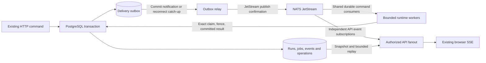

# Phase 6A: NATS messaging foundation

## Intent and decisions

Replace routine PostgreSQL job discovery and live SSE polling with NATS
JetStream delivery. Preserve all delivered Phase 1–5 features, application
state, authorization, pinned configuration and operator setup. PostgreSQL
continues to store authoritative runs, messages, events, checkpoints,
operations, Connector data and artifact metadata.

The user confirmed on 2026-10-25 that the roadmap numbering remains **6A for
messaging** and **6B for generated code**, and selected a **drained cutover in
a brief maintenance window**. Broker selection was already accepted in the
[architecture](../../architects.md). The detailed design and accompanying
plan were approved for implementation on 2026-10-26. Production cutover remains
separately gated on completed qualification and operator readiness.

This is one migration capability, delivered through four dependent boundaries:
`durable-publication` → `fenced-delivery` → `live-events`; `deployment` packages
and qualifies all three. It does not add a second workflow runtime.

Read the [source review](../../reviews/2026-10-25-phase6a-messaging-review.md)
for the current implementation and alternatives. Recommended approach:
transactional outbox plus notification-driven relay. Direct dual writes have
a commit/publish gap; a permanently polling relay misses the accepted target;
CDC introduces an unnecessary additional service for this installation.

## Compatibility and scope

**Always preserve:**

- Existing authenticated HTTP submission/cancel/resume/read contracts and
  accepted run IDs; idempotent client requests and exact retry payloads.
- Event UUIDs, per-conversation sequences, event types/payload projections,
  snapshots, history, assistant messages and auto-titles. Broker sequences
  never become browser cursors or application event identities.
- Project isolation, archive/restore, operator-only global management,
  global search reuse, project defaults, tool enablement/deployment ceilings,
  Connector waits, explicit resume/dismiss/expiry and secret-safe audit.
- All persisted graph/execution versions, pinned provider/profile/Connector
  revisions and budgets; AWS basic-role discovery and bounded SDK reads;
  legacy references retain their historical meaning.
- Lease ownership, fences, committed dispatch boundaries, attempt accounting,
  interrupted/uncertain outcomes, tool slot admission and atomic publication.
- Artifact bytes, IDs/digests, filesystem backend, stable storage and
  installation IDs, quotas, tombstones, Connector keyrings and lock files.
- Existing local process entry points and `docker compose up --build` for the
  development stack; add the required broker and relay setup explicitly.
  No re-creation of existing databases, volumes, accounts or Connectors.

**Never:** retry a model/cloud effect because a broker delivery, HTTP wait or
reply timed out; put credentials, prompts, artifact bodies or arbitrary Python
handler names into general broker messages; fall back to a competing polling
scheduler; silently reset broker storage or repoint existing artifact volumes.

**Outside scope:** sandbox drivers/images, generated code, mutable file heads,
external event triggers, new providers/tools/cloud roles, new public APIs for
workflow scheduling, Kubernetes/ECS/Helm and multi-host high availability.
No promise of exactly-once external effects or zero-downtime migration.

## Topology and application authority

Use an asynchronous Python NATS client in API/relay/worker supervision. Keep
synchronous graph/SDK/SQLAlchemy work in bounded execution threads with their
own sessions and per-slot execution objects/checkpointer connections. A broker
callback never runs a graph or waits on synchronous SQL. Do not share a mutable
`Worker` or SQLAlchemy session across concurrent turns. Preserve process signal
handling at the supervisor boundary and close checkpointer contexts on exit.

Initial proposed capacity: four chat/run slots and one background slot per
worker process; `TOOL_CONCURRENCY` and pinned provider/tool limits remain
independent ceilings. `run.execute` covers both existing chat and manual tool
runs. Fetch only when a matching execution slot is available, with bounded
batch size and aggregate consumer pending limits. Multiple worker processes
share the same compatible durable consumer; API replicas never share a
competing event consumer. Ordering is per application conversation, not a
global FIFO promise. Existing one-active-run admission remains authoritative.

## Durable records and publication

Extend the existing outbox additively rather than drop its table:

| Record | Required addition or invariant |
| --- | --- |
| `run_jobs` | Retain ownership/lease/fence; enforce one row per run after auditing duplicates. Add `dispatch_generation` (initial 1). It identifies an admission opportunity, not a provider attempt or fence. |
| `outbox` | Explicit destination (`command`, `event`, `control`), schema version, stable message ID, subject, bounded reference envelope, run/generation where applicable, publication attempts, next retry, publisher claim/expiry and safe last error. `processed_at` means confirmed publication, never execution. |
| Event notification uniqueness | Exactly one event-destination row per retained event, enforced by a partial unique index. A control or command row can refer to the same event without colliding. |
| Command uniqueness | Unique `(run_id, dispatch_generation, destination=command)` and message identity; deterministic UUID derived from installation/run/generation. Initial submit, explicit Connector resume and **safe pre-dispatch requeue** insert a command in the same transaction. |
| Delivery ledger | Persist command dispositions and maintenance-task state by message ID, including original identity/digest, handler version, disposition and safe error. Duplicate deliveries consult the current application state; an orphaned `in_progress` entry cannot block recovery forever. |
| Migration state | A singleton transport gate, cutover ID/epoch, backfill progress and verification results. Unknown/wrong epochs cannot dispatch. It is independent of the existing managed-Connector dispatch lock. |

Command envelopes are immutable once created. On broker reconstruction or a
later forward cutover after rollback, increment each safely queued run's
dispatch generation, supersede its old command/outbox disposition, and create
a new command identity bound to the new epoch in one transaction. Never alter
an already published envelope to carry another epoch. Retrying the same
cutover ID resumes the same epoch/generations rather than incrementing again.

Consolidate all semantic event writes through a transactional helper that also
enqueues an event reference. Audit direct `Event(...)` constructors and existing
manual `Outbox(...)` writers, including admission, provider attempts, terminal
errors/title updates, tool publication/recovery, Connector blockers and artifact
maintenance. Remove duplicate manual notification creation as callers move to
the helper. Tests must cover every producer family, including exceptional
worker exits. No event is considered live-deliverable unless its outbox is
committed with it. SQLite unit tests use the same application helper; real
PostgreSQL tests prove transactions, constraints and notifications.

An additive PostgreSQL trigger on **outbox insertion** sends a content-free
`pg_notify('openship_outbox', '')` wakeup. The relay uses a dedicated committed
LISTEN connection, then scans committed pending rows in bounded batches.
It holds a session advisory lock so one relay actively publishes initially;
another relay may take over after connection loss. No application transaction
stays open while awaiting NATS. Publisher row claims expire and can be retried.
Only broker-confirmed publications set `processed_at`. Lost confirmation is
republication with the same `Nats-Msg-Id`; application deduplication remains
necessary beyond the broker window.

On startup or either DB/broker reconnect, LISTEN first, then catch up all
eligible pending rows and drain accumulated wakeups. During idle operation,
wait for notifications; there is no recurring empty-outbox SELECT. Failed
publications/abandoned claims schedule a bounded retry timer. Pending future
work schedules a timer for its due time. A periodic lease/Connector-expiry
reconciler remains a recovery function, not job discovery. The listener must
use a real session connection, not transaction-pooled PgBouncer.
This ordering follows [PostgreSQL LISTEN](https://www.postgresql.org/docs/15/sql-listen.html);
notifications are a wakeup, with rows retaining durability, as described in
[NOTIFY](https://www.postgresql.org/docs/15/sql-notify.html).

Preserve per-conversation event publication order using the recorded sequence;
parallel relay work must not publish a later notification before an earlier
pending one. A later observed sequence also triggers bounded DB gap repair.
Events retained for broker recovery cannot be deleted while their unpublished
outbox references still need them. Retention of published notifications/ledger
records is bounded and documented; durable run state still prevents duplicate
execution after ledger cleanup.

## Wire contract, routing and broker ownership

Envelope v1 contains `schema_version`, `message_id`, `kind`, `installation_id`,
`transport_epoch`, `correlation_id`, `causation_id`, `source_service`,
`created_at`, plus applicable `project_id`, `conversation_id`, `run_id`,
`dispatch_generation`, `event_id` and `sequence`. Commands contain references
to persisted admitted configuration, never credentials or executable handler
selectors. Validate a maximum 16 KiB encoded envelope, UUIDs, supported kind,
schema/epoch and the DB identity/digest before claiming. Subject tokens are
server-generated, validated identifiers. The installation namespace is `I`:

| Subject | Consumer and purpose |
| --- | --- |
| `openship.I.v1.command.run.execute` | Shared `run-v1` durable pull consumer for exact existing chat/tool runs. |
| `openship.I.v1.command.maintenance.retention` | Separate `maintenance-v1` durable pull consumer; explicit operator-enqueued existing retention task. No new automatic retention policy. |
| `openship.I.v1.event.CONVERSATION` | Independent API-instance consumers, multiplexed in-process to authorized SSE clients. Reference-only semantic event notices. |
| `openship.I.v1.control.RUN` | Independent interested worker subscriptions; cancel/fence-change wakeup. Never a shared competing execution consumer. |
| `openship.I.v1.failure.KIND` | Confirmed quarantine notices referring to inspectable safe failure records. No original untrusted payload copied verbatim. |
| `openship.I.v1.rpc.worker.health` / `openship.I.v1.reply.API_INSTANCE.REQUEST` | Bounded internal health request/reply and server-owned response subjects. Not durable work admission. |

Service accounts are installation-scoped: bootstrap/admin manages streams and
consumer configuration; relay publishes durable traffic; runtime consumes
commands/controls and publishes only approved replies/failure notices; API
consumes events and its own replies and sends the bounded health RPC. Runtime
services may use only the exact JetStream consumer operations their role needs,
with necessary ack and private inbox subjects. No blanket `$JS.API.>` access
for application identities. API instances may create/delete only their named
event consumers, or use bootstrap-provisioned names. Test the actual ACLs,
including NATS API/ack subjects and reply spoofing, against the pinned server.
Application project authorization is checked after message receipt and before
loading/projecting data; a subject is never authority. Use
[NATS authorization](https://docs.nats.io/reference/config/authorization) as
the broker permission mechanism, alongside application checks.

The API mints one API-instance UUID and a request UUID for each worker health
check. It subscribes to the exact
`openship.I.v1.reply.API_INSTANCE.REQUEST` subject and flushes that subscription
before publishing to `openship.I.v1.rpc.worker.health`. Requests and replies
bind schema, kind, installation, API instance, request and source service. A
worker replies only while its run consumer, recovery supervisor, broker
topology and authoritative execution gate are ready. Multiple workers may
receive the core request; the API accepts the first strictly bound ready reply.
Workers that are not ready remain silent, so no responder yields the same safe
unavailable result as a timeout. The full RPC wait is at most two seconds.
This is an internal probe; public HTTP health routes remain a separate concern.

A durable run response, where used internally, references its committed
outcome and original correlation; SSE remains the public progress channel.
Disappeared reply subscriptions, no responders and timeouts never alter run
outcomes or authorize a new effect. JetStream's delivery acknowledgement reply
subject is reserved for broker ACKs. See
[NATS request/reply](https://docs.nats.io/concepts/request-reply).

## Stream and consumer proposal

All streams use file storage, one replica and explicit bounded resources.
These are proposed initial values, qualified in the deployment slice:

| Stream | Subjects | Retention / limits |
| --- | --- | --- |
| `OS_RUNS` | run command | Work queue; 512 MiB; no age expiry; reject new at capacity. |
| `OS_MAINTENANCE` | maintenance command | Work queue; 128 MiB; no age expiry; reject new at capacity. |
| `OS_EVENTS` | event notices | Limits retention; 256 MiB / 24 hours; oldest notices may expire; DB history is authoritative. |
| `OS_CONTROLS` | control notices | Limits retention; 64 MiB / 24 hours; owner checks also read durable state. |
| `OS_FAILURES` | safe failure notices | Limits retention; 128 MiB / 7 days; durable failure ledger survives notice expiry. |
| `OS_ADVISORIES` | pinned MaxDeliver advisory for `OS_RUNS.run-v1` | Work queue; 64 MiB; no age expiry; reject new at capacity. |

Commands have a two-minute duplicate window, explicit ACKs, 30-second AckWait
and progress ACK every 10 seconds while supervised. Proposed `MaxDeliver=10`;
transient pre-dispatch failures use delayed NAKs of 1, 5, 15, 30, then at most
60 seconds. Do not simultaneously rely on a different implicit backoff policy.
`MaxAckPending` equals the declared aggregate slots for that consumer, not the
number of users; changes in replica capacity require a checked config update.
Do not delete shared durable consumers when one worker exits. API/control
consumers have independent names, bounded pending queues and a five-minute
inactive cleanup threshold; durable worker consumers have no inactivity
deletion. Control filters cover only active runs; initial DB checks and
supervisor safety checks cover subscription races and missed notices.

The required `exhaustion-v1` durable on `OS_ADVISORIES` explicitly ACKs the
exact `$JS.EVENT.ADVISORY.CONSUMER.MAX_DELIVERIES.OS_RUNS.run-v1` subject, uses
all-message delivery, a 30-second AckWait, unlimited redelivery, one file-backed
replica and no inactivity deletion. The stream persists server advisories while
the worker is offline; `exhaustion-v1` must be bound before run intake becomes
ready. Runtime credentials may inspect and delete an exact `OS_RUNS` source
sequence only after the terminal/requeue observation or failure handoff commits;
they cannot read or delete messages in another stream. The 64 MiB advisory
budget is finite. `DiscardNew` can reject new capture at capacity; the
corresponding source stays in `OS_RUNS`, but the current supervisor cannot
discover an advisory that was not retained, and this slice has no operator
command to identify such sequences. Production cutover requires a tested 75%
capacity alert and a reviewed full-capacity per-sequence reconciliation tool
and procedure. At the alert threshold, operators pause execution consumers
while the exhaustion observer drains. At full capacity, keep them paused until
the tool has reconciled retained source messages against PostgreSQL. This is a
production acceptance gate, not an automatic recovery path.

NATS retains messages that hit MaxDeliver; it does not automatically move
them to a dead-letter queue. The recovery supervisor must inspect exhausted
deliveries/advisories on startup/reconnect and during its bounded recovery
cycle, persist disposition and publish a failure reference before terminating
or removing the original delivery. Failure of quarantine leaves the original
recoverable. Malformed messages are quarantined immediately. Operator replay
validates current run/generation/dispatch state and cannot reset a terminal or
uncertain run into execution. Exact API details must be verified against the
selected release; the [consumer contract](https://github.com/nats-io/nats.docs/blob/master/nats-concepts/jetstream/consumers.md)
describes explicit acknowledgements and exhaustion. Stream retention and
bounded deduplication follow the [JetStream model](https://github.com/nats-io/nats.docs/blob/master/using-nats/jetstream/model_deep_dive.md).

An exhaustion observation is keyed to the authoritative installation,
transport epoch and exact `OS_RUNS` sequence. The advisory's delivery count is
diagnostic only. A live owner remains in `watching_live_owner` until its fenced
lease changes or a committed run outcome permits settlement. Recovery verifies
the source subject, JetStream timestamp and stored body digest before exact
sequence deletion. Uncertain dispatch or mismatched source identity remains
blocked with the source retained. A durable observation resumes this check
after a worker restart; the durable advisory stream preserves an event that
arrived while no worker was bound.

For immediate run-message quarantine, store a content-free failure record
keyed by installation, the authoritative `messaging_state.transport_epoch`,
JetStream source stream and stream sequence. The source stream must be
`OS_RUNS`; never use an untrusted envelope epoch or subject as source identity.
Store JetStream's message timestamp as provenance, not as a generation key.
The transport epoch must remain unchanged until source deliveries and failure
handoffs in that epoch are resolved; rotate it before recreating `OS_RUNS` so
reused stream sequences cannot collide with the prior stream generation. The
record stores a fixed classification/error code, body digest and optional UUID
references parsed from a fully valid envelope; never persist the raw body or
untrusted subject. A conflict for the same source identity with a different
digest or classification is unconfirmed and leaves the original delivery
recoverable; store the conflicting digest/classification as a separate
content-free observation for operator diagnosis without modifying the
canonical failure.

In the same PostgreSQL transaction, insert one `destination='failure'` outbox
row referencing the failure record. The source delivery may be ACKed only after
that transaction commits, the reference notice receives a JetStream PubAck,
and the outbox `processed_at` marker commits. The consumer may claim only that
failure's exact outbox row and must use the same publisher claim/lease and
settlement functions as the general relay. If the general relay already owns
the lease, the consumer waits for its committed marker or retries after the
lease expires; it never publishes around the lease. No database transaction
remains open across a broker publish. A failed or uncertain PubAck/marker
leaves the original delivery recoverable and schedules a delayed NAK so it
releases a run slot. If retries reach `MaxDeliver`, B2e.4 must recover the
durable failure handoff and complete the source disposition only after the
notice is confirmed. Notices contain only the stable `failure_id` reference
and use a stable `Nats-Msg-Id`. Because JetStream's
duplicate window is bounded, notices are at-least-once across a sufficiently
long uncertain publish; any failure-notice consumer must durably deduplicate
by `failure_id`. The notice keeps the common v1 envelope fields, sets
`kind` to `failure.KIND`, and adds only `failure_id`; it has no conversation,
run, project, correlation or causation fields. The classification appears in
the fixed failure subject suffix and does not copy the diagnostic error code.

Malformed messages require trusted JetStream metadata. If stream, sequence or
timestamp cannot be read or validated, retain the source delivery without
creating a failure row. Reconcile outcomes that may have a live owner or an
uncertain external effect (including `ownership_moved` and
`ownership_expired`) remain recoverable and cannot use the generic quarantine
handoff to authorize ACK. B2e.4 owns their durable observation and safe
terminal/requeue decision. A future reconcile handler may ACK only after it
proves and commits a safe state repair, then completes the same failure
handoff.

Failure records and their outbox rows do not cascade with run or conversation
deletion. Failure outbox rows require a failure-record reference and carry no
run, event or conversation foreign-key scope; only failure rows may have a
null conversation. The ledger has no automatic pruning in this slice. B2e.5
must add explicit bounded retention that never removes an unprocessed failure
outbox row.

Before classifying exhaustion as failure, inspect the authoritative run and
lease under the established locks. A healthy owned run can outlive ten
redeliveries after progress-ACK loss; MaxDeliver alone must never fail it or
repeat its effect. Persist a `watching_live_owner` disposition with the run,
generation and next lease-check time, retain the exhausted broker message,
and let bounded recovery supervision observe until a committed outcome/wait
or lease expiry. Completion permits cleanup; expiry follows existing safe
requeue/uncertain-dispatch rules and durably hands off before cleanup.
Recovery resumes these observation records after restart even if the broker
advisory was missed. Malformed unclaimed messages do not enter this path.

## Delivery state machine and recovery

1. Reserve a matching execution slot; validate envelope and persisted identity.
2. Lock in the existing conversation → run → job → operation order, check
   generation/epoch/status, and acquire that run's fenced lease atomically.
   No query selects a different queued job. Recheck `available_at` before
   dispatch; if not due, delay delivery without holding a lease.
3. A terminal run or obsolete generation is a committed no-op disposition.
   Another live owner means defer/observe, never execute concurrently. Do not
   ACK an active owner's only recoverable work notification prematurely.
4. Invoke existing execution with live ownership checks, pinned configuration,
   budgets and committed dispatch markers. Renew DB lease and broker progress
   independently; a progress ACK is not an application lease renewal.
5. Commit assistant/result/event/operation changes atomically. A durable
   Connector wait releases its slot and ACKs this generation; explicit resume
   increments the generation and creates a new outbox command. A safe recovery
   requeue does the same, fencing the previous owner.
6. ACK with confirmation only after committed result, terminal no-op, durable
   wait or durable replacement handoff. Lost ACK leads to a state check on
   redelivery, not another effect. Uncertain dispatch follows the existing
   `model_interrupted` / `execution_interrupted` policy and fails visibly.

The explicit maintenance task calls the existing retention implementation with
fixed validated arguments and operator identity; retain direct maintenance CLI
behavior for recovery. Its ledger records requested/running/completed/failed
and dry-run result. Repeating an uncertain task does not create a second
untracked operation; interrupted maintenance requires inspection before replay.

NATS disconnect: stop fetching; let already executing work keep its DB lease
and complete safely, with results waiting in outbox. On DB ownership loss,
cancel through existing supervision and publish nothing under a stale fence.
Keep the existing 0.5-second cancellation/fence safety check and 10-second
lease renewal initially; replace normal dispatch/SSE polling only. Tool-policy
refresh, Connector expiry and 60-second lease reconciliation remain bounded
safety/maintenance timers and must run independently of active turns.

## Live SSE without a subscription gap

Preserve existing routes and response projections. Authenticate and authorize
the conversation before subscribing. Each API process owns its event consumer
and multiplexes clients locally; each message contains only identifiers.

For a new client or broker reconnect: establish/confirm the live subscription,
buffer notices, capture a committed conversation high-water sequence, read
events through that point in bounded pages on short-lived off-loop DB
sessions, then drain/deduplicate buffered notices. Read gaps from DB before
advancing the application cursor. Notices may arrive twice or out of order;
only increasing contiguous application sequences are sent. Snapshot recovery
handles pruned history; a captured snapshot must represent a coherent DB view.
Broker stream sequence is only an internal delivery cursor.

Use a maximum 256 notices per client. If overflow/gap/history expiry prevents
safe continuation, emit the existing `snapshot.required` and close; never
block worker ACK or advance past unsent events. Heartbeat comments remain at
15 seconds. A broker loss closes affected streams so the existing browser
snapshot recovery runs; reconnecting establishes catch-up before live traffic.
There is no database SELECT every heartbeat or idle second.

Continue emitting the existing event UUID in SSE `id`. Accept both legacy
integer `Last-Event-ID` and UUID headers resolved to a sequence **inside the
authorized conversation**; header takes precedence over query when valid.
Keep `after_sequence` integer and current invalid/future/pruned behavior.
Unknown/pruned UUIDs require snapshot recovery. Add header tests to resolve the
present UUID/integer mismatch without changing stored IDs or browser types.

## Configuration, admission and operational limits

Add `NATS_SERVERS`, `NATS_AUTH_FILE`, optional `NATS_TLS_CA_FILE`,
`NATS_TLS_CERT_FILE`, `NATS_TLS_KEY_FILE`, `NATS_NAMESPACE`,
`WORKER_RUN_CONCURRENCY` (4), `WORKER_BACKGROUND_CONCURRENCY` (1),
`MESSAGING_OUTBOX_MAX_PENDING` (10,000) and
`MESSAGING_OUTBOX_MAX_AGE_SECONDS` (300). Auth files contain role-specific
credentials, never URL passwords logged in errors. Require matching
installation/namespace/epoch and compatible handler versions across processes.
Keep all existing settings and credential/storage paths; retire
`WORKER_POLL_INTERVAL` with a clear configuration diagnostic, without silently
enabling a legacy scheduler. No permanent runtime backend selector.

Admission and execution gates are independent: closing admission rejects new
user work while active runs can drain. Closing execution prevents normal
command pulls/new dispatch, while allowing already-owned work to finish with
leases renewed. Maintenance/cutover keeps normal pulls stopped, so commands
cannot burn through MaxDeliver while the installation is deliberately closed.
A smoke test uses a separate disposable namespace with an explicit synthetic
handler; it cannot release production queued work or reach live providers.

When the broker is down, accept a submission only if its DB transaction can
durably store the command within the backlog ceilings; the run stays queued.
Enforce pending-count/oldest-age ceilings under a serialized admission gate
so concurrent submissions cannot exceed the bound. At the ceiling reject
**before inserting** message/run rows with HTTP 503, a safe unavailable code
and retry guidance. Cancellation remains persistable while admission is
closed. No provider request occurs without durable admission. Liveness stays
process-only; readiness reports DB, broker, expected streams/consumers, relay
freshness, outbox age and execution capacity, without exposing credentials.
Read-only history and recovery endpoints remain available during degradation.

The [deployment runbook](../../operations/messaging.md) owns environment
commands and operator checks. Use one persistent single-node broker for all
initial modes, with a 2 GiB file-store ceiling above the configured stream
budgets. Production proposes `sync_interval: always`, qualified against the
pinned server and storage; development may use `1s`. Disk sync trades throughput
for durability; a publish ACK alone must not be described as protection from
every storage/power failure. See [NATS disk synchronization](https://docs.nats.io/reference/config/jetstream/sync_interval).
Single-node Compose has restart recovery, not host-failure availability.

## Cutover, rollback and restore contract

Use additive migrations from the actual Alembic head. Preserve old tables and
columns through the rollback window; no destructive schema migration is part
of 6A. Migration dry-run is read-only and emits counts/conflicts without
prompts, secrets or raw envelopes. Apply is bounded, resumable and idempotent:

- Close write admission and drain old workers; reconcile expired work using
  existing dispatch rules. Stop old API/workers so they cannot ignore the new
  transport gate. Check no live owner remains before backfill.
- Record cutover ID/epoch and backups. Audit duplicate job rows/conflicting
  identities; fail rather than choosing one silently.
- Backfill explicit commands for queued, undispatched runs only. Preserve
  waiting Connector runs; resume later creates a command. Terminal runs never
  become commands. Dispatched uncertain runs become visible failed outcomes.
- Backfill one event-reference notification for retained events missing one;
  normalize legacy outbox rows as event notices without treating them as
  commands. Preserve UUIDs/sequences. Missing/pruned events get a recorded
  historical disposition; they cannot block cutover forever.
- Provision and verify broker resources, start relay/new workers/API under
  closed admission, reconcile and smoke-test synthetic work, then reopen.
  Event and run ledgers prove every eligible generation has one disposition.

Rollback closes admission before execution, drains or reconciles active work,
then stops the API, worker and relay processes and drains the JetStream
consumer. Preview blocks old live owners, unresolved command claims or
exhaustion, active retention, pending command/maintenance publications, and
identity conflicts. Apply requires explicit operator/process/consumer
attestations and repeats those checks under the transport-state lock. It marks
the transport inactive, keeps both gates closed, records a fresh rollback
epoch, requeues retained event references for a later forward migration, and
increments each safe queued run's dispatch generation. Old command records
remain immutable, so they cannot match the new epoch/generation. Waiting runs
keep their waits. Retain additive schema; never downgrade away new records.
Only deploy the old release after a successful report confirms no unaccounted
or uncertain executable work.

A later forward cutover uses a new cutover ID and reuses the persisted rollback
epoch. The rollback already rotated away from the previous broker epoch, and
the queued generation increments create new command identities; reusing this
epoch also keeps the unique event-reference rows aligned with transport state.
The old cutover ID remains an audit record and cannot be reused for a forward
apply.

Coordinated restore keeps **all** execution/admission closed, not only managed
Connector dispatch. Restore a matched PostgreSQL/artifact/broker/config backup
set and separately protected keys, verify artifact identity and ciphertext,
then audit every pending command against current DB state before enabling
consumers. An older database may predate already performed external effects:
never automatically replay restored in-flight commands. Uncertain effects
require operator reconciliation. Broker-only loss can reconstruct safe queued
work from DB with a new epoch and new dispatch generations; do not reset
published flags and replay blindly.
Backup includes consumer state and failure ledger, following
[NATS recovery guidance](https://docs.nats.io/learn/backup-recovery/).

## Acceptance and evidence

All following gates are required before marking 6A implemented/accepted:

1. Existing unit, real-PostgreSQL and synthetic full-stack/browser journeys
   pass: authentication, chat/titles/profiles/fallback, retry, cancellation,
   Connector wait/resume/dismiss, global/project isolation and defaults, tool
   availability, AWS discovery/reads, archives and artifact lifecycle.
2. Real broker tests prove DB rollback emits no executable command, lost
   PubAck and ACK are harmless, redelivery after the dedup window is safe,
   stale generations/fences cannot publish, and crashes before/after each
   dispatch/commit boundary preserve current interruption semantics.
3. Two API instances both stream the same authorized conversation; subscribe
   races, replay/live overlap, pruned cursors, UUID/numeric headers, broker/API
   restart and slow-client overflow have no silent gaps/duplicate messages.
4. Idle worker/SSE/relay traces show zero recurring job discovery, event-table
   or empty-outbox queries. Document remaining lease/security/maintenance
   timers. Separate background work cannot consume reserved run slots.
5. Fifty synthetic conversations, two API processes and at least two workers
   exercise multiple slots with a slow provider fixture and concurrent
   maintenance. Proposed local qualification targets: p95 submit/read latency
   ≤500 ms, event commit→SSE ≤1 s, runnable command→free-slot start ≤1 s,
   cancellation of local I/O ≤2 s. Record hardware, limits, queue wait under
   saturation, CPU/RSS/DB connections and fixture delays. Synthetic capacity
   is not a live-provider claim; target changes require explicit review.
6. Local, development Compose and production Compose clean install/upgrade/
   restart/stop/restore exercises pass using real built images and volumes.
   Full disk, broker outage, ACL denial, bad schema/subject, exhausted delivery,
   resource drift and secret rotation yield inspectable, bounded failures.
7. Dry-run/apply/rerun/resume and rollback are exercised on populated Phase 5
   fixtures containing queued/running/terminal/waiting runs and old event
   cursors. Required broker/PostgreSQL/deployment lanes cannot pass by skipping.
8. Documentation and environment examples agree with the shipped scripts.
   Publish exact qualified server/client/CLI versions and image digests,
   durability limits and measured recovery time. User acceptance is separate
   from successful tests.

Exact release pins are a builder qualification task, not a claim made by this
source review. Check server support for every proposed setting before locking
the matrix. No dependency installation or runtime migration occurs as part of
this documentation proposal.
