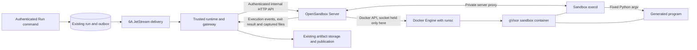

# Phase 6B: Generated code and controlled artifacts

## Intent and decision status

Let a project owner upload deployment logs, ask OpenShip to write a Python
parser, inspect its captured source, execute that exact version against selected
inputs, and retain a summary and report after the sandbox is destroyed. Later
edits produce new versions without changing the code or inputs of earlier runs.

This is the next increment in the [roadmap](../../roadmap.md#6b--generated-code-and-controlled-artifacts).
It extends the [artifact and execution foundation](2026-10-19-phase4-execution-and-conversation-workspace-design.md)
and [6A messaging](2026-10-25-phase6a-nats-messaging-design.md), and implements the
[sandbox boundary](../../architects.md#12-sandbox-architecture). It does not
introduce another application scheduler, graph engine, artifact store, or
browser event protocol.

**Baseline:** repository revision `5fe6e03`, the merged Phase 6A implementation
(PR #31). The user reports 6A implemented. Some roadmap, architecture, runbook,
and qualification descriptions still predate that merge; they are not evidence
that production cutover or every acceptance scenario passed. Phase 6B can be
specified now; enabling it requires the applicable 6A qualification and user
acceptance, with earlier journeys carried forward.

**Status:** implementation is in progress and no isolation qualification is
claimed. The current work includes configuration preflight, optional Compose
packaging, immutable logical-file capture and bounded UTF-8 edits from existing
artifacts, a disabled source inspection/editor UI, and protocol/cleanup
coordination tests. The UI's Run action remains disabled. The complete
admission-to-publication execution path, PostgreSQL concurrency qualification,
and real gVisor isolation/recovery qualification remain outstanding. On
2026-10-28 the user selected a standalone
[OpenSandbox Server](https://github.com/opensandbox-group/OpenSandbox) as the
Sandbox Manager service alongside OpenShip, using its Docker backend with
gVisor locally and preserving a later Kubernetes deployment path. OpenShip
requests execution and waits for captured output/results without receiving
the Docker socket. This choice supersedes the earlier proposal for an
OpenShip-built host manager, custom execution protocol and manager journal.
Other resource defaults and explicit execution UX remain proposals for review.

## Scope and recommended approach

Treat 6B as one controlled-code-execution capability: versioned source and
inputs form an admitted bundle; one isolated attempt produces captured outputs.
Its dependent boundaries are `captured-files` → `execution-bundle` →
`sandbox-attempt` → `artifact-publication`. Installation and qualification
cover that complete journey. A file editor or an installed driver alone does
not complete the phase.

| Approach | Trade-off and disposition |
| --- | --- |
| Execute Python in the API/runtime process, or use ordinary containers | Smaller initial patch, but violates the architecture's untrusted-code isolation boundary. Excluded. |
| Standalone OpenSandbox Server using its Docker backend and gVisor `runsc` | User-selected approach. Reuse upstream lifecycle, execution and file APIs; deploy the server alongside OpenShip in Compose. OpenShip retains application policy and durable publication. |
| OpenShip-built host manager and driver | Superseded. Duplicates lifecycle/protocol work supplied by OpenSandbox and complicates the intended local-to-Kubernetes deployment path. |
| MicroVMs or an external execution service | Valid later providers, but add infrastructure or external data handling before the first local parser works. Deferred; preserve a narrow driver interface. |

The first dependency profile is **CPython 3.11, standard library only** in a
prebuilt, pinned OCI image. Record the exact patch release in the qualified
image manifest. No `pip install`, generated Dockerfiles, runtime image builds,
user-selected images, shell entrypoints, or network-enabled dependency
resolution. Additional dependency profiles and runtimes require separate
qualification through these contracts. The image must also support the pinned
OpenSandbox execd/bootstrap and protected supervision described below; the
generated Python program still has only the standard library. Do not replace
the image entrypoint with the submitted source or require a Jupyter image.

The initial execution path is an explicit **Run this version** action. The
model can create or propose source and file edits; it cannot start the sandbox
without that command in this increment. This keeps the inspected bundle
identifiable without implementing Phase 8's durable approval requests. It is
not approval for cloud access, mutation, or future executions.

**Preserve:** authentication and project ownership; conversation archive rules;
existing provider/profile pinning, search, Connector/AWS reads and tool policy;
run IDs, idempotency, leases/fences, cancellation, checkpoints, outbox/JetStream
dispatch, event UUIDs/sequences and SSE replay; artifact IDs, storage identity,
quotas, tombstones, and existing downloads. Historical execution and manifest
versions retain their original interpretation.

**Outside this phase:** cloud credentials in generated code; any external
network access; arbitrary executables, packages, MCP servers or shell tools;
HTML/SVG execution or rich active previews; saved workflows and durable human
waits; automatic execution by the model; Kubernetes/ECS; multiple sandbox
hosts, failover, shared artifact storage, and stronger isolation providers.
Kubernetes remains a later deployment qualification, using OpenSandbox's
Kubernetes backend rather than introducing a separate OpenShip pod controller.

## Current implementation and required extensions

Paths below are relative to `apps/api/src/openship/` unless stated otherwise.

| Evidence at the baseline | Required extension |
| --- | --- |
| `artifacts/models.py` constrains kinds to upload/search/cloud observation, media to JSON/plain text, and every stored artifact to immutable. | Add generated-source/report/log kinds as needed. Keep byte versions immutable; add logical heads separately. Plain text and JSON suffice for the first profile. |
| `artifacts/service.py` owns reservations and quota/lifecycle transitions; `filesystem.py` verifies bytes and storage identity. | Reuse these paths for all source captures and sandbox outputs. Extend validation and reservations deliberately, including deletion pins and recovery. |
| `capabilities/contracts.py` versions manifests/configuration, uses strict frozen models and canonical digests, and accepts only maintained execution. `catalog.py:require_phase4_dispatchable` rejects other kinds. | Add an explicit versioned sandbox capability/configuration variant. Do not reinterpret old maintained manifests, relax all dispatch checks, or dynamically import generated source. |
| `execution/admission.py` validates supported graph versions and pins input refs; `publication.py:mark_tool_dispatching` reserves known tool outputs and records dispatch intent. | Add supported graph/configuration versions, bundle admission and bounded multi-output reservations/publication through the same gateway and operation ledger. |
| `ToolOperation`, `ToolAttempt`, `ExecutionSlot` provide logical calls, one physical attempt per operation, fencing and shared capacity. | Retain those identities and the one-attempt invariant. Add sandbox-specific detail records rather than independent run/operation status. |
| `runs/tool_graph.py` executes model-free commands through `ToolGateway`; `runs/routes.py` accepts `POST /api/runs/{conversation_id}/tools`. | Use that command path for Run this version. New chat file-write capabilities use the shared bounded tool loop; execution itself stays manual initially. |
| `ConversationFiles.vue`, the artifact store, and operation/run cards expose immutable files and progress. | Add source editing, version history, bundle inspection, an execution action, and output links in the existing workspace. |
| The merged messaging runtime supervises concurrent slots; no sandbox manager/driver exists in this source tree. | Package a standalone OpenSandbox Server and add a narrow client adapter in the trusted worker. Only the manager infrastructure receives the engine socket; API/runtime/generated code do not. |

## User journey and public contracts

1. Upload a bounded UTF-8 deployment log using the existing upload contract.
   Select it explicitly; uploads remain immutable snapshots.
2. Ask for a parser that writes `summary.json` and `report.txt`. A maintained
   `workspace_write_file` capability validates and captures text; it does not
   execute it. The model receives artifact/file IDs and bounded excerpts.
3. Open the source in the conversation files panel. Show its immutable version,
   digest, selected inputs, dependency profile, requested outputs, and limits.
   The Python source remains plain text even if named `parser.py`.
4. Run this version submits a model-free `python_execute` capability command
   through `POST /api/runs/{conversation_id}/tools`, with the existing client
   request identity. The server recomputes the bundle from authorized refs;
   the browser supplies neither execution authority nor host paths.
5. The existing run card shows admitted/running/terminal progress, bounded
   diagnostics, and captured output links while the worker awaits the bounded
   OpenSandbox execution/result exchange. Cancellation uses the existing run
   command. Reconnect uses the same snapshot and SSE sequence contracts.
6. The user reads/downloads the outputs after sandbox destruction, edits the
   parser, and runs the new version. Both runs retain their exact provenance.

Proposed additive file endpoints, all authenticated and conversation-scoped:

| Command/query | Contract |
| --- | --- |
| `POST /api/conversations/{conversation_id}/files` | Create a logical text file and first immutable capture. UUID idempotency key, bounded content/name and digest; return file ID, version ID and artifact ref. |
| `GET /api/conversations/{conversation_id}/files` | Cursor-paginated logical files with current captured refs; keep the existing artifact listing usable. |
| `GET /api/conversations/{conversation_id}/files/{file_id}/versions` | Cursor-paginated history with immutable refs and provenance; no artifact bytes in list responses. |
| `PUT /api/conversations/{conversation_id}/files/{file_id}/content` | Bounded replacement text, expected base version and UUID idempotency key. Atomically capture and advance the head, or return `409 file_version_conflict`. |
| `DELETE /api/conversations/{conversation_id}/files/{file_id}/versions/{version_id}` | Explicitly prune a capture's bytes if no current head or active execution pins it. Retain a version/artifact tombstone and digest; return an actionable 409 if pinned. |
| `DELETE /api/conversations/{conversation_id}/files/{file_id}` | Tombstone the logical file; do not silently delete retained captures or bypass artifact deletion pins. |

Use the repository's existing upload/read transfer conventions where applicable;
do not add unbounded JSON/base64 transfers. The file-write tool calls the same
service as these endpoints. Successful creation/edit returns a new immutable
artifact ref. Retrying the same key with the same payload returns the same
result even after the head has advanced; different payload returns conflict.
Wrong-owner/project/conversation IDs return the existing non-disclosing 404
shape. Archived scopes reject writes/execution under existing lifecycle rules.

Editing a source, changing selected inputs, runtime image, dependencies,
outputs, or limits clears the UI's pending Run selection and requires a fresh
bundle inspection. Admission with a stale expected source head fails with
409. Once admitted, a run uses its immutable captured refs even if the logical
head later advances; it never switches to the latest bytes at dispatch.

## Logical files and immutable capture

Add a conversation/project-scoped `LogicalFile` identity and append-only
`FileVersion` records linking it to ready `Artifact` versions. A file has a
current version, display name, timestamps and tombstone state; a version records
its parent/base, artifact ref, actor and optional originating run/operation.
Enforce scope consistency and unique file/version identity in the database.
Renames are metadata changes and cannot change captured bytes or old run refs.

Use an expected-base compare-and-swap under the existing scope/quota locking
order. Two edits of the same base produce one head advancement; the loser gets
the current version ID and can reload. No automatic merge or last-writer-wins.
For bounded full-text replacement, no patch language is needed initially.

An uploaded artifact is not silently converted to a logical file. A user may
explicitly create one from an authorized capture; the old artifact stays valid.
Each declared step output has `mutability: immutable | mutable`. A mutable
output still produces a new immutable artifact/version and an atomic head
update against its declared base; immutable outputs never create a head.
Execution reports default to immutable. A mutable output conflict fails the
publication transaction; it cannot overwrite a newer user edit.

All captures count against existing conversation/project byte and count quotas,
including old versions. Current heads and active execution refs pin their
captures, including source, parameters, inputs and staged outputs through
terminal cleanup. History/provenance records do not pin bytes indefinitely.
Completed captures are retained by default, without automatic ready-file
expiry in this increment. Users explicitly prune superseded versions through
the endpoint above; ordinary immutable reports retain the existing artifact
delete action. The UI explains that pruning removes reproducibility from any
completed execution referencing those bytes. IDs/digests/provenance remain
readable as tombstones, and later reads report deleted content, never substitute
another version. Reusing a deleted ref for execution is refused.

Check pins across all file heads and active operations, not only the selected
file's history. Tombstoning a logical file releases its head pin, but does not
delete bytes automatically. Explicit pruning or the existing operator workspace
purge initiates deletion; existing retention maintenance recovers incomplete
deletions/staging, not expiry of ready captures. Extend both paths for logical
heads and sandbox source/input pins, preserving archive rules and quota
accounting. A purge with active execution pins still fails visibly.

## Execution bundle and admission

Introduce a strict, schema-versioned bundle using existing `canonical_json`
and `canonical_digest` conventions. Reject unknown fields, duplicate input or
output aliases, malformed digests and unsupported profile versions.

The bundle covers:

- Capability ID/version/manifest digest; runtime/profile and pinned OpenSandbox
  server/execd/API compatibility versions; image digest and dependency-lock digest, including an explicit empty
  third-party dependency set for the standard-library profile.
- Source `ArtifactRef` and optional source file/base version; selected input
  refs with server-validated simple aliases; fixed entrypoint and bounded
  JSON parameters exposed as a read-only file, without shell interpolation.
- Declared output aliases/media types/mutability and expected bases where
  applicable; effective CPU, memory, process, storage, time, output and
  concurrency policy; workload egress=`deny` and credentials=`none`. Restricted
  manager-to-execd control traffic is infrastructure traffic, not program
  permission to reach the network.

The server derives ownership and execution identity from the authenticated
request and live claim, not caller-supplied principal/project fields. Resolve
logical refs to immutable ready versions at admission; verify artifact scope,
storage readiness, digests, effective tool policy and worker/profile readiness.
Pin source, inputs and required quota reservations before dispatch. An artifact
can be readable yet unsuitable as an input because it is unavailable/deleting.

Bind installation ID/transport epoch, principal/project/conversation/run,
operation/attempt, owner/fence and bundle digest into OpenShip's durable
execution record. Send only necessary correlation metadata to OpenSandbox;
metadata and its installation API key do not make OpenSandbox an evaluator
of OpenShip user authority or database fences.
Keep the content bundle digest separate from the request digest, so provenance
can compare the same program/inputs across runs without conflating authority.
Current policy revocation, lost claims or archive/cancellation block dispatch
and publication under the existing rules; a pinned bundle cannot override them.

Do not route `python_execute` through Connector selection, AWS clients, or
credential resolution. Adding it to the installed catalog does not enable it
on an unqualified host. Keep global deployment ceilings and project tool policy
authoritative. Historical manifests/configurations decode without new defaults
that grant execution.

## Execution plane: standalone OpenSandbox Server



Run the upstream `opensandbox-server` as a distinct service alongside OpenShip.
Its Docker backend owns sandbox create/inspect/delete and endpoint resolution;
the injected execd supplies command execution, streams and file transfer. Use
the upstream Python SDK where its pinned version meets the bounded-transfer
contract; a narrow HTTP client is acceptable for missing SDK surfaces. Do not
fork the lifecycle server, implement another Docker driver, or add another
public OpenShip execution service.

Only OpenSandbox Server and any specifically qualified lifecycle guard in that
manager deployment have engine administration access. The API, model/runtime
container and sandbox never receive the socket. OpenSandbox has **no OpenShip
DB, NATS or Connector credentials** and no durable artifact-store mount. Its
own upstream metadata/store paths use a separate volume, not OpenShip tables.
Treat the server as trusted infrastructure because engine access is powerful.

OpenShip owns a narrow `execute(bundle)` adapter in the trusted gateway. It
waits asynchronously for the result within the supervised run; the browser
still gets an accepted run and observes existing SSE events. The user's
`POST /execute` diagram expresses this logical request/response boundary:
OpenSandbox does not document that as a single native route. Map the operation
to the actual lifecycle and execd APIs below instead of inventing that route.

| Stage | Upstream API and OpenShip responsibility |
| --- | --- |
| Create | `POST /v1/sandboxes` with a pinned image, fixed bootstrap, explicit 120 s TTL, CPU/memory limits and bounded OpenShip correlation metadata. The server selects gVisor through configuration, never a model argument. Persist create intent first. |
| Ready and bind | Inspect `GET /v1/sandboxes/{id}` and use endpoint resolution/SDK readiness. Persist the returned sandbox ID against the exact operation/attempt before submitting any generated code. Reject unexpected lifecycle state, endpoint origin or profile. |
| Transfer | Use execd file APIs through the server proxy to upload only source, parameters and selected inputs into fixed per-sandbox paths. Bound streaming bytes; verify size/digest after materialization. Do not expose generic filesystem APIs to the model/browser. |
| Execute and wait | Foreground execd `POST /command` with fixed native `argv`, `background=false`, non-root workload UID/GID and `timeout=30000` ms. Consume bounded stdout/stderr and completion/error events through the SDK/proxy. No shell interpolation and no Jupyter/code context required. |
| Capture | On explicit successful completion, stop remaining workload descendants while execd remains alive, then download only declared regular output files. Verify size/digest locally and publish through OpenShip's artifact service. |
| Destroy | Call `DELETE /v1/sandboxes/{id}` in cleanup on success/failure/cancel; check backend-specific terminal/removal evidence. Accepted deletion alone is not proof that all processes stopped. |

Configure SDK `use_server_proxy=true` so the worker uses the private server
endpoint for execution/file traffic as well as lifecycle calls. Choose the
server's internal-IP or host-mapped proxy resolution for the actual Compose
network and verify reachability; do not guess sandbox IPs or publish execution
ports to users. Authenticate lifecycle/proxy access with the upstream
`OPEN-SANDBOX-API-KEY` header, provisioned as a worker/server secret. Retain
endpoint authentication headers where supplied; protect execd from direct
unauthenticated access. Do not assume Docker `secureAccess` support merely
because the lifecycle schema contains the Kubernetes gateway option.

Private local Compose HTTP with an API key is allowed on the isolated control
network. Production/remote service traffic uses HTTPS with peer verification,
via a private reverse proxy or service mesh if upstream does not terminate TLS.
Mutual TLS may strengthen that deployment; it is no longer a custom native
manager-protocol prerequisite. The API/browser/model receive no manager key.
Never put manager/endpoint tokens into the generated process environment,
source, artifacts, checkpoints or semantic events. Rotate secrets outside images.

The server API is broader than OpenShip's capability. The adapter fixes image,
argv, environment, filesystem paths and limits and rechecks current authority
and fences immediately before dispatch/publication. OpenSandbox does not
validate OpenShip claim fences, bundle digests or project ownership. Omit
unneeded pools, snapshots, shell sessions, credential vaults, network policy
sidecars and renewal/auto-pause machinery from the first profile.

OpenSandbox request IDs/metadata provide correlation, **not an assumed
exactly-once execution guarantee**. Keep create and command-dispatch intent in
the existing OpenShip attempt record, not a new manager journal. Disable
automatic retries of create and command POSTs, including SDK/transport retries.
If create response is lost, reconcile by installation/attempt metadata using
the lifecycle listing; destroy matching orphan(s) and interrupt the attempt,
without another create or code submission. If command response is lost after
dispatch, inspect the known sandbox/command where possible, destroy/reconcile
it, and report interrupted unless a complete verified result already exists.
Never resend Python because a stream or HTTP/NATS acknowledgement was lost.

Use bounded metadata encodings compatible with upstream label limits; store
full authority/digests in PostgreSQL. On startup and periodically for recovery,
reconcile OpenShip attempt records with installation-scoped OpenSandbox
instances, including uncertain creates and unknown/multiple matches. Reaping
orphaned physical instances is recovery, not another application scheduler.
Block new sandbox admission while the manager or reconciliation is unhealthy.

Replace the earlier custom sliding 5 s/15 s ownership-renewal protocol with a
fixed, non-renewed sandbox TTL and enforced program deadline. OpenShip retains
its DB leases/fences and cancellation path, but does not claim those leases
are enforced natively by OpenSandbox. A worker loss can leave an orphan only
until the independently enforced hard lifetime; stale work cannot publish.
Upstream Docker expiration currently uses server-process timers and restores
tracking on restart, so a declared TTL alone does not prove enforcement while
that server is down. Qualify a protected image lifetime supervisor or a
manager-deployment lifecycle guard that survives lifecycle-server failure.
Prefer existing upstream mechanisms where proven; keep any required guard
small and outside generated code, without creating a second manager API.
Admission stays disabled if this deadline guarantee cannot be demonstrated.
Host/kernel outage timing is outside the guarantee; reap before reopening
after host recovery and report interruption.

### Compose deployment and later Kubernetes

Add `opensandbox-server` to the development and production Compose packaging,
with a pinned release image, explicit configuration, a separate upstream
metadata volume, required API-key secret, healthcheck and restart policy. The
runtime worker receives only its internal URL and client credential. The server
alone mounts the Docker socket. Generated sandbox containers are created on
demand by OpenSandbox and are not static Compose services.

Use separate private control and sandbox-data networks. Only the server and
trusted worker share the control endpoint; generated sandboxes never join the
OpenShip DB/NATS/API network. The server must reach execd on the data network,
and only that inbound management connection and established replies are
allowed. Enforce denial of new workload-initiated traffic to the internet,
DNS, metadata, host services, other sandboxes and manager/control-plane ports
outside the sandbox. An internal bridge alone does not deny same-host peers.

Upstream explicitly documents gVisor incompatibility with its current egress
sidecar and rejects gVisor plus `networkPolicy`. Do not configure that rejected
combination or drop egress denial to make the example work. For Docker qualify
host firewall/bridge controls covering forwarded, host-bound and same-bridge
IPv4/IPv6 traffic; for later Kubernetes use network-layer/CNI enforcement.
Do not set engine/runsc networking to `none` when it makes execd unreachable.
The policy is denied program egress with narrowly scoped management access.

The upstream Compose example is a connectivity starting point, not the final
OpenShip configuration: add auth/secrets, gVisor, bounded storage, runtime
limits and network controls; remove public server/execd port exposure. Pin and
test proxy routing across Compose and Docker-created sandbox networks.
`runsc` still has to be installed/registered on the Linux daemon host before
Compose enables executable capabilities; OpenSandbox does not install it.

Later Kubernetes deployment switches the same OpenSandbox integration to its
Kubernetes backend and a configured gVisor RuntimeClass. Qualify its controller,
RBAC, namespace/network policy, endpoint/proxy routing, storage and cleanup
then. Preserve bundle/result/artifact/run contracts; Docker qualification does
not claim Kubernetes readiness or lifecycle-server HA.

## First support profile, image, and hard limits

Proposed reference target: Linux x86_64, Ubuntu 24.04 LTS, cgroup v2, Docker
Engine with a separately registered gVisor runtime dedicated to this profile.
Configure the standalone server with `runtime.type = "docker"`,
`secure_runtime.type = "gvisor"` and `secure_runtime.docker_runtime = "runsc"`.
For later Kubernetes use `runtime.type = "kubernetes"` and
`secure_runtime.k8s_runtime_class = "gvisor"`. These are deployment settings,
not arguments selected by generated code.
Use the qualified `runsc` platform and record kernel, engine, runsc checksum,
OpenSandbox server/SDK/execd versions, runtime flags and all image digests as
one support tuple. Exact compatible release
pins are an implementation/qualification deliverable; no current patch or
platform is asserted qualified by this document.

Native development and development/production Compose use this same manager
boundary. An application stack running under Podman does not establish a
qualified Podman sandbox driver. For macOS/Windows, use a documented Linux VM
with the same profile; qualify that route separately before advertising it.
Unsupported hosts retain chat and artifact access, with actionable execution
unavailability. Never fall back to host Python, `runc`, or a weaker runtime.

Build one minimal image from a digest-pinned Python base, with a distinct
non-root workload UID/GID, protected supervision and OpenSandbox-compatible
bootstrap, no OpenShip code/secrets and no third-party Python packages. The
image stays alive for execd transfer/execution/collection; it does not exit
with the generated program. Keep execd/control files and tokens inaccessible
to that workload identity, and do not inherit the execd environment into it.
Version the Dockerfile, lock metadata, SBOM and scan results; verify
build provenance and compare dependency inventory in repeat builds. Execute by
digest, preload during installation, and disable runtime pulls. Record build
tool/base inputs; do not claim bit-for-bit reproducibility unless measured.

Proposed defaults below are acceptance targets, not measured capacity. Effective
limits are the minimum of installed profile and gateway policy; a request may
reduce them. Raising a ceiling requires a newly qualified profile revision.

| Resource/control | Initial ceiling and enforcement |
| --- | --- |
| Runtime | Fixed `/usr/bin/env -i PATH=/usr/local/bin:/usr/bin:/bin /usr/local/bin/python3 -I -B /code/main.py`; no shell. Clear the inherited execd environment before Python starts. `-I` reduces environment/path injection but is not the security boundary. |
| Credentials/network | Empty inherited workload environment, small fixed allowlist, no manager/endpoint/application secrets; deny new workload egress at the network layer while permitting manager-initiated execd traffic and replies. No host networking or public sandbox ports. |
| Identity/filesystem | Non-root, drop all workload capabilities, no-new-privileges and qualified runtime syscall controls; read-only root, source and inputs. No host PID/IPC namespaces, devices or administrative sockets. |
| Time | 30 s program wall time via explicit execd timeout and protected supervision; 120 s absolute sandbox lifetime covering preparation/transfer/collection. Independently enforced even on lifecycle-server failure; 2 s graceful termination then forced kill, verified stopped within a further 3 s. |
| Ownership | Existing DB leases/fences remain authoritative; no custom manager lease protocol. Explicit OpenSandbox TTL is never omitted, renewed or extended by access. Worker loss triggers reconciliation and at most the remaining fixed lifetime of physical work. |
| CPU/memory | Create with CPU `1` and memory `512Mi`; this sandbox budget includes execd/supervisor overhead. No additional workload swap allowance; account manager/runsc/Gofer overhead and reserve host capacity separately. |
| Processes/FDs | At most 32 workload tasks and 128 open FDs; qualify guest task limits as well as host cgroup process limits. A host PID count alone cannot prove the guest limit. |
| Source/inputs | Source ≤256 KiB; at most 8 selected inputs, each ≤8 MiB and aggregate ≤16 MiB. Inputs materialize under server-generated aliases in `/inputs`, never original display paths. |
| Writable data | `/tmp` ≤64 MiB; `/outputs` ≤16 MiB and 128 filesystem entries/inodes. Bound all other writable mounts, including shared memory; no unbounded writable overlay or engine log files. |
| Published outputs | At most 8 declared files, each ≤4 MiB, aggregate ≤8 MiB, plus one diagnostic log ≤256 KiB. Reserve byte/count quotas before start. |
| Logs | stdout and stderr combined ≤256 KiB; drain through bounded buffers and terminate on excess. Escape control/ANSI sequences in UI; never use an unbounded engine log driver. |
| Concurrency | One sandbox attempt per installation initially, with an aggregate host reservation; additionally obey existing run/tool slot ceilings. No new unbounded manager queue. |

Use OpenSandbox file transfers into isolated per-attempt sandbox paths; no
shared writable conversation mount or complete artifact-store mount. Keep
the sandbox/execd alive after Python exits until outputs have been copied to
OpenShip staging. Delete the sandbox only after capture or a deliberate failed
capture; never expect container tmpfs to survive its destruction.

The qualified profile must enforce hard byte/inode bounds on every writable
root/overlay and on OpenSandbox metadata/staging/log storage. Periodic disk
sampling and output-download limits alone do not bound sandbox disk growth.
Upstream API CPU/memory fields and Docker named-volume size hints do not prove
those bounds. Identify a compatible server profile, protected image/runtime
setup or small upstream extension and demonstrate it before enabling execution.
Likewise verify bootstrap/execd injection with the required read-only paths,
workload task/FD limits and protected deadline supervisor; these are integration
qualification requirements, not presumed OpenSandbox defaults. Do not replace
the selected service with a custom lifecycle implementation if a gap appears.
Record any required upstream extension explicitly before implementation.

No program output can grow storage outside the bounded roots. Stop workload
descendants before collection while preserving execd. Collect only declared
simple filenames; reject links, directories, FIFOs/devices, traversal, unsafe
names and duplicate aliases. Validate file type/link metadata and avoid a
check/read race through the qualified file API; refuse unsafe output if those
properties cannot be established. Recheck transfer length/digest locally.
Never unpack a sandbox-created archive on the host. Document swap policy and
temporary-data retention; the remote file API cannot grant host file access.

## Publication, failures, and recovery

Keep `ToolOperation` statuses and run terminal meanings. Add a sandbox detail
record keyed to the existing attempt for OpenSandbox endpoint/profile identity,
request and bundle digests, server/execd/image pins, absolute deadline,
create/command-dispatch phase, sandbox/command IDs, exit reason
and cleanup disposition. Keep physical cleanup state separate from logical
success/failure so failures cannot disappear when a run becomes terminal.

1. Under a live claim, admit the operation, pin captures, acquire existing and
   sandbox capacity, reserve output/log quotas, and commit dispatch intent
   before sending a start request. Calls over the wire never hold a DB lock.
2. Create through OpenSandbox, persist its ID, transfer/verify selected bytes,
   commit command-dispatch intent under a live claim, then issue the fixed
   Python command once. Await the bounded result stream asynchronously, without
   holding a DB transaction or blocking broker/API supervision. Ambiguous
   create/command responses follow the non-retry recovery contract above.
3. When the program exits, terminate remaining workload descendants and seal outputs.
   The trusted runtime streams bounded files into the existing artifact staging
   service and independently verifies length/digests and plain-text/JSON shape.
4. In one fenced DB transaction, publish all required output refs, provenance,
   operation outcome, optional logical-head changes and semantic events/outbox.
   Success requires an explicit successful command completion/zero exit status
   and all declared outputs valid/within quota. HTTP 200, a sandbox being
   Running, an SSE disconnect or missing completion is not success. Normalize
   upstream events without inferring an omitted exit code. No subset is
   represented as a successful report.
5. Destroy the sandbox and attempt directories; release reservations/capacity
   using idempotent cleanup. Artifacts already published remain in durable
   storage. A cleanup failure marks the host unhealthy for new sandboxes,
   records pending cleanup and alerts the operator; it cannot permit overcommit.

After a failure, cancellation or timeout, discard report outputs and optional
head changes; retain only bounded, authorized diagnostic evidence under quota
and retention policy. Previously captured code and inputs remain. A diagnostic
cannot be mistaken for a successful report. If publication fails midway, staged
bytes remain unadvertised and existing maintenance reaps/reconciles them.

| Failure | Observable result and recovery |
| --- | --- |
| No qualified manager/image, exhausted capacity or quota | Explicit unavailable/capacity/quota reason; no physical start and no fallback. A retry is a deliberate new command where necessary. |
| Code/input/profile/digest mismatch | Reject before start with `execution_bundle_changed` or transfer validation error. Do not substitute latest versions or fetch missing dependencies. |
| Nonzero exit, missing/unsafe output, resource excess | Failed operation with a stable reason such as `program_failed`, `invalid_output`, `time_limit_exceeded`, `memory_limit_exceeded` or `output_limit_exceeded`; bounded diagnostics and cleanup. Attribute a resource reason only when evidence supports it. |
| Cancellation, revoked policy, archive, lost fence or worker crash | Request OpenSandbox destruction where reachable and reject late publication. Independent program/lifetime enforcement bounds orphaned code even if the lifecycle server cannot be reached; no TTL renewal. |
| OpenSandbox crash during prepare/start/run | Independent supervision preserves deadlines. After restart, reconcile OpenShip records with scoped upstream instances/metadata before reopening admission; stop incomplete attempts, never restart Python. Uncertain dispatch is `execution_interrupted`. |
| Runtime crash after start or before publication | Existing dispatch fence/one-attempt rules prevent replay. Reconcile interrupted state, reap staged output and destroy the known sandbox or let its enforced hard lifetime expire; a physical exit alone cannot fabricate committed success. |
| Duplicate NATS command or lost reply | Existing run claim/delivery disposition and operation uniqueness return current state. Do not assume native OpenSandbox create/command deduplication: no automatic POST retry, no second process or duplicate artifact publication. |
| Manager unreachable during stop/destroy | Logical cancellation may commit immediately; physical cleanup remains pending. Block new sandbox admission until reconciliation verifies no active orphan and capacity is safe. |
| DB/artifact/OpenSandbox restore | Restore authoritative DB/artifact data together, preserve upstream metadata as documented, reconcile and reap old instances before enabling execution. Restore does not restore/replay Python processes or reissue recorded command POSTs. |

Emit existing `tool.*`, run and artifact projections through transactional
event/outbox helpers. Add only versioned fields/events needed for bundle,
logical-head and cleanup detail; no artifact bodies, source text, broker
credentials, certificate keys or raw engine errors in broadcasts. Browser
reconnect reads DB projections; live log streaming is optional and cannot be
the only retained failure evidence.

## Downloads and previews

Keep artifacts private under existing owner/project authorization. Preserve
verified download reads, `Content-Disposition: attachment`, `nosniff` and
`Cache-Control: no-store`. Show Python/plain text with escaped text nodes and
JSON with bounded parsing/depth/size and text fallback. A `.html` or `.svg`
filename never selects an active renderer. Generated reports are plain text
or JSON in this profile; no HTML iframe, script-capable Markdown, raw `v-html`,
or arbitrary MIME expansion is required. Preview and filename tests include
script tags, event handlers, SVG payloads, traversal, bidi/control characters,
oversized JSON and ANSI escapes.

## Migration, installation, and operation

- Add schema migrations for file/version and sandbox detail records, new
  artifact kinds and explicit manifest/execution/graph versions. Old artifact
  bytes/IDs and immutable constraints remain intact; backfill is unnecessary
  for logical heads. Migration tests cover existing Phase 4–6A data and
  SQLite unit fixtures plus real PostgreSQL constraints/concurrency.
- Upgrade API/runtime/relay contracts compatibly. Old workers must not claim
  new sandbox work: initially drain and stop all old workers, migrate, deploy
  a homogeneous new worker set, verify, then open sandbox admission. Keep the
  capability disabled throughout; no new message subject may bypass 6A gates.
- Package the standalone OpenSandbox Server in Compose and provide preflight
  for host runsc registration, server/execd/workload image verification,
  API-key/proxy/TLS setup, host egress rules, storage quotas, protected deadline
  supervision, cgroup/guest-limit probes and cleanup reconciliation. Do not auto-modify the
  system's default runtime, silently restart Docker, or enable execution after
  an incomplete preflight. Host administration steps and downtime are explicit.
- Add a sandbox operations guide linked from the existing
  [artifact](../../operations/artifact-storage.md) and
  [messaging](../../operations/messaging.md) runbooks. Cover native/Compose
  connectivity, certificate rotation, disabling execution, storage-full,
  abandoned instances, pinned-file retention, backup and restore rehearsal.
- Back up source/report artifacts and file/version/bundle metadata with the
  current database/artifact pair; preserve upstream metadata/store volumes and
  endpoint configuration for ordinary restart. Restore reconciles the existing
  OpenShip attempt ledger against OpenSandbox instances before admission.
  Temporary sandbox output is not the authoritative backup.
- Rollback disables sandbox/file writes, drains or interrupts attempts, verifies
  cleanup and retains additive metadata/artifacts. Prefer the new binary with
  the feature disabled; an older binary that cannot read new artifact/config
  variants is not a safe rollback target. Document any required maintenance
  restore explicitly; never relabel new records as legacy maintained tools.
- Expose sandbox-specific readiness and metrics: supported tuple, image and
  manager availability, active attempts, queue/prepare/run/collection latency,
  resource terminations, reserved/staged bytes, proxy/stream failures, pending
  cleanup and oldest orphan age. Chat/history readiness remains independent
  where the existing service permits it.

## Repository shape, style, and verification commands

Extend existing `artifacts/`, `capabilities/`, `execution/`, `runs/` and event
modules. Proposed `sandboxes/` contains strict bundle/profile/result contracts,
the OpenSandbox client adapter and attempt reconciliation/publication helpers.
No OpenShip Docker driver, custom manager server or separate manager journal
is required. Keep engine administration out of `ToolGateway` and browser routes.
Place OpenSandbox configuration, qualified profile/image and service packaging
under `deploy/sandbox/`, with the server service wired into existing Compose
definitions. Pin the Python SDK in `apps/api/pyproject.toml`/lockfile if used;
do not vendor the upstream server. Exact internal filenames are
builder choices, not new architecture commitments.

Use SQLAlchemy/Alembic, Pydantic and existing transaction ownership conventions.
For example, reuse this existing style from `capabilities/contracts.py`:

```python
class FrozenModel(BaseModel):
    model_config = ConfigDict(extra="forbid", frozen=True, strict=True)


def canonical_digest(value: Any) -> str:
    return hashlib.sha256(canonical_json(value)).hexdigest()
```

Tests belong alongside existing artifact/gateway tests, PostgreSQL integration
tests, real-runtime sandbox tests, and full-stack browser journeys. Add a
dedicated opt-in `sandbox` pytest marker and a qualified Linux runner lane;
ordinary unit CI may exclude that lane, but phase acceptance may not replace
it with mocks. Keep existing thresholds and checks; do not invent a coverage
percentage or weaken quality gates to accommodate the new service.

Existing executable checks (run in the indicated directory):

```bash
# apps/api — baseline unit/contract lane; no real-service qualification claim
uv run ruff check .
uv run pytest -q -m 'not postgres and not provider_live and not full_stack and not jetstream'

# apps/api — existing PostgreSQL and messaging lanes; services configured per CI/runbook
uv run pytest -q -m 'postgres and not jetstream' tests/integration
uv run python scripts/qualify_jetstream.py

# apps/web
pnpm typecheck
pnpm test:run
pnpm build
pnpm test:e2e:full-stack
```

Required **new** qualification entrypoints, to be implemented/documented rather
than assumed to exist today:

```bash
# apps/api — on the declared Linux host, with preflight/configured real services
uv run pytest -q -m sandbox tests/sandboxes
uv run pytest -q -m 'postgres and not jetstream' tests/integration

# apps/web — extend the existing full-stack configuration with the parser journey
pnpm test:e2e:full-stack

# repository root — after the proposed service/config/secrets have been implemented
docker compose up -d opensandbox-server
docker compose logs --tail=100 opensandbox-server
```

After introducing the marker, exclude `sandbox` from the ordinary unit command
and run it explicitly in its real-host lane. The implementation plan must give
exact installer, manager startup, preflight and qualification commands after
their CLI contracts are designed. No sandbox commands or tests were run to
validate this specification-only change.

## Acceptance and evidence package

All numbers above are proposed gates. Record actual measurements, failures,
hardware, dataset, version tuple and limitations; do not report synthetic model
traffic as live-provider qualification.

| Gate | Required evidence |
| --- | --- |
| Useful parser | Exact setup, sample logs, generated captured source and expected results. Run twice with different logs; retained summary/report bytes match the recorded refs after sandbox destruction and application restart. |
| Exact bundle | Inspect/admit/execute digests match. Tampering with code, inputs, parameters, image/dependency/profile/limit data rejects dispatch. Editing after admission leaves the admitted immutable version unchanged. |
| Concurrent editing and pruning | Real PostgreSQL concurrent edits of one base yield one winner/one conflict; idempotent retries return the original capture. Publication conflict cannot change an unrelated/newer head. Pruning refuses all head/active-execution pins, frees quota only after verified deletion and keeps historical IDs/digests readable with explicit deleted-content state. |
| Authorization | Deny wrong owner/project/conversation refs, unselected input reads, archive writes, disabled policy, stale/altered bundles and lost OpenShip fences. Missing/wrong manager keys and untrusted endpoint/proxy routes fail. Workload cannot read execd/manager tokens or invoke privileged execd operations through loopback. Secret canaries and unrelated host/project files are inaccessible. |
| Real isolation | On the actual OpenSandbox/runsc profile, verify runtime selection and probe host paths/sockets/devices, privilege changes, metadata/control-plane endpoints, DNS, IPv4/IPv6 egress and same-bridge peers. Management proxy still works. Missing runsc/unsupported profile refuses execution; no weaker fallback or incompatible egress-sidecar configuration. |
| Exhaustion | Infinite loop, memory pressure, fork/thread bomb, FD exhaustion, scratch/output byte and inode exhaustion, stdout/stderr flood, oversized/unsafe files all remain bounded; unrelated chat stays responsive. Verify guest task ceilings and host overhead as well as container flags. |
| Preview/transfer | Hostile names/links/content cannot escape storage or execute browser code; authenticated bounded downloads have correct digests and headers. Only declared outputs are published. |
| Cancellation/recovery | Lose create and command replies; inject worker/server crashes before execution, during SSE, staging/publication and after commit. No create/command POST is replayed automatically; duplicates cannot start a second program. Prove program and absolute sandbox deadlines while the lifecycle server is down. Reconcile metadata-scoped orphans, including multiple/unknown matches; late results cannot publish. |
| Cleanup | Normal success/failure/cancel/timeout stops code within the declared bounds. Restart reaps abandoned attempts within 60 s of manager recovery. Cleanup failure blocks new sandbox work and retains inspectable evidence; no byte/count/slot leak remains after reconciliation. |
| Deployment/migration | Native worker plus standalone server and the selected Compose profile demonstrate install, private proxy reachability, worker without engine socket, unsupported-host behavior, upgrade, API-key/TLS rotation, storage-full, feature-disable rollback and coordinated restore. Old chat/search/Connector/artifact/SSE journeys pass through 6A. Kubernetes remains later qualification through the same API integration. |
| Measurement | Twenty sequential parser executions and ten concurrent submissions under the one-sandbox ceiling record admission/queue/start/run/collection times, peak memory/storage and cleanup. Excess capacity is bounded/reported; no hidden queue grows without limit. |

Unit tests prove validation, canonical digests and state transitions; real
PostgreSQL proves constraints, quota/CAS and fenced publication; real
JetStream proves existing command/event delivery and duplicate recovery;
real runsc proves isolation and limits; browser tests prove inspection,
editing, exact execution, reconnect, cancellation and safe output access.
Mocks are useful for protocol failures but cannot establish sandbox safety.

Phase completion requires a runnable increment, operator guide, reproducible
demonstration, pass/fail evidence, earlier-journey continuity, failure/recovery
results and a user decision to accept, revise or reject. Passing unit tests or
installing runsc alone is insufficient.

## Research basis

Primary documentation consulted on 2026-10-28. These sources establish tool
semantics; the concrete OpenShip defaults and protocol above are proposals.

| Source | Finding and consequence |
| --- | --- |
| [OpenSandbox server architecture](https://github.com/opensandbox-group/OpenSandbox/blob/main/docs/architecture/control-plane/server.md) and [implementation compatibility](https://github.com/opensandbox-group/OpenSandbox/blob/main/docs/api/implementation-compatibility.md) | Lifecycle and execution are separate APIs. Use a single-active standalone server and preserve the application boundary when changing its backend later. |
| [Lifecycle API](https://github.com/opensandbox-group/OpenSandbox/blob/main/specs/sandbox-lifecycle.yml) | Use create/inspect/delete and correlation metadata; set TTL explicitly. Do not infer execution idempotency, fence validation or Docker endpoint authentication from unrelated API fields. |
| [Execd API](https://github.com/opensandbox-group/OpenSandbox/blob/main/specs/execd-api.yaml) and [execd behavior](https://github.com/opensandbox-group/OpenSandbox/blob/main/docs/architecture/data-plane/execd.md) | Fixed native argv, timeout, bounded streams and file capture fit the parser without Jupyter. Require explicit completion, preserve control-token separation and capture before destruction. |
| [Secure runtime guide](https://github.com/opensandbox-group/OpenSandbox/blob/main/docs/guides/secure-container.md) | gVisor is selected server-side after host installation. The documented egress-sidecar incompatibility requires external network enforcement; do not use gVisor plus `networkPolicy`. |
| [Server configuration](https://github.com/opensandbox-group/OpenSandbox/blob/main/server/configuration.md) and [Docker Compose example](https://github.com/opensandbox-group/OpenSandbox/blob/main/server/docker-compose.example.yaml) | Adapt upstream configuration with secrets, runsc, private routing and limits. Do not copy insecure/public defaults or mistake a volume capacity hint for a Docker hard quota. |
| [Python SDK](https://github.com/opensandbox-group/OpenSandbox/blob/main/sdks/sandbox/python/README.md) and [single-host network](https://github.com/opensandbox-group/OpenSandbox/blob/main/docs/architecture/network/single-host-network.md) | Use server-proxy mode and qualify server-to-sandbox routing independently from worker-to-server connectivity. |
| [Docker lifecycle implementation](https://github.com/opensandbox-group/OpenSandbox/blob/main/server/opensandbox_server/services/docker/docker_service.py) | Expiration uses process timers and restart reconciliation. Independent deadline enforcement is a qualification requirement rather than an assumed property of a declared TTL. |
| [gVisor Docker quick start](https://gvisor.dev/docs/user_guide/quick_start/docker/) and [production guide](https://gvisor.dev/docs/user_guide/production/) | Runtime registration is explicit and compatibility/performance need deployment qualification. Select the registered runsc profile and record the full support tuple. |
| [gVisor security model](https://gvisor.dev/docs/architecture_guide/security/) | Isolation reduces exposed host interfaces but does not grant authorization or eliminate resource exhaustion/side channels. Keep credentials out and enforce host-level budgets. |
| [gVisor resource model](https://gvisor.dev/docs/architecture_guide/resources/) | Guest processes do not correspond directly to host processes. Qualify guest task limits and account runtime/memory behavior rather than trusting host PID flags alone. |
| [gVisor networking](https://gvisor.dev/docs/user_guide/networking/) | Host networking reduces isolation. Preserve execd management reachability while enforcing denied workload egress externally; qualify the actual topology. |
| [gVisor filesystem](https://gvisor.dev/docs/user_guide/filesystem/) | Runtime overlays and mount behavior affect where writes land. Pin flags and verify read-only paths and bounded writable roots against the actual provider. |
| [Docker resource constraints](https://docs.docker.com/engine/containers/resource_constraints/) and [run reference](https://docs.docker.com/reference/cli/docker/container/run/) | Limits must be configured explicitly; runtime administration is powerful. Confine engine access to the manager and test effective controls. |
| [Docker tmpfs mounts](https://docs.docker.com/engine/storage/tmpfs/) | Container tmpfs data disappears on stop and may reach host swap. Capture through execd before destroying the sandbox, bound writable roots, and document swap policy. |
| [Python 3.11 command line](https://docs.python.org/3.11/using/cmdline.html) | `-I` excludes environment/user-path influence and `-B` avoids bytecode writes. Neither replaces OS/runtime isolation. |
| [MDN: X-Content-Type-Options](https://developer.mozilla.org/en-US/docs/Web/HTTP/Reference/Headers/X-Content-Type-Options) | Explicit content types and nosniff complement attachment delivery; previews still require safe text rendering. |

## Review decisions and implementation boundary

The user-selected architecture is standalone OpenSandbox Server alongside
OpenShip with a gVisor backend, initially Docker Compose and later Kubernetes.
It replaces the proposed custom manager, journal and lease API. Recommended
defaults still needing review are the standard-library Python profile,
explicit Run this version action, initial Linux x86_64 support and one sandbox
at a time. The main expansion choices—automatic model execution,
third-party dependencies, other runtimes and host providers—remain excluded
until separately specified and qualified.

Exact upstream release/SDK/image pins, Compose/proxy settings, network rules,
quota provisioning, protected supervision and internal module splits are
builder choices within these requirements. Research used upstream `main`, not
a qualified release. Before enabling execution, a compatibility spike must
prove bootstrap/read-only storage, workload/control-daemon separation,
bounded streams/files, host egress denial and deadlines under manager failure
on the pinned tuple. Document any missing native control and its small
profile/upstream addition; do not claim default upstream configuration already
implements OpenShip's policy. A failed check blocks qualification, not permits
weaker isolation or replacement of the selected manager architecture.

**Always:** reuse the existing authority/runtime/storage contracts; validate
all refs; pin immutable content and profiles; fail closed; record dispatch and
cleanup; preserve historical versions; run applicable checks.

**Review a spec change first:** credentials/network access, automatic execution,
new runtime/dependency/provider support, stronger authority, multi-host scope,
or weakening any limit/isolation/compatibility gate.

**Never:** execute generated code in trusted application processes; grant a
sandbox DB/broker/engine credentials or arbitrary host mounts; bypass fences,
quotas or archive policy; rewrite captured bytes; silently retry uncertain
dispatch; publish secrets or advertise mock tests as isolation evidence.

This deliverable ends at the proposed spec. Implementation planning and code
follow only after review; Phase 6A deployment acceptance remains a distinct
prerequisite to enabling the new capability.
